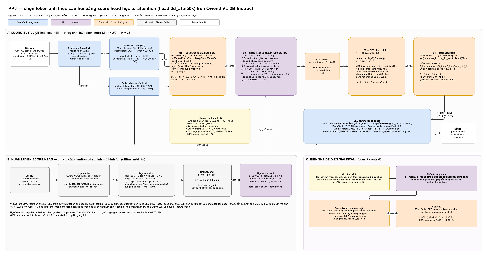
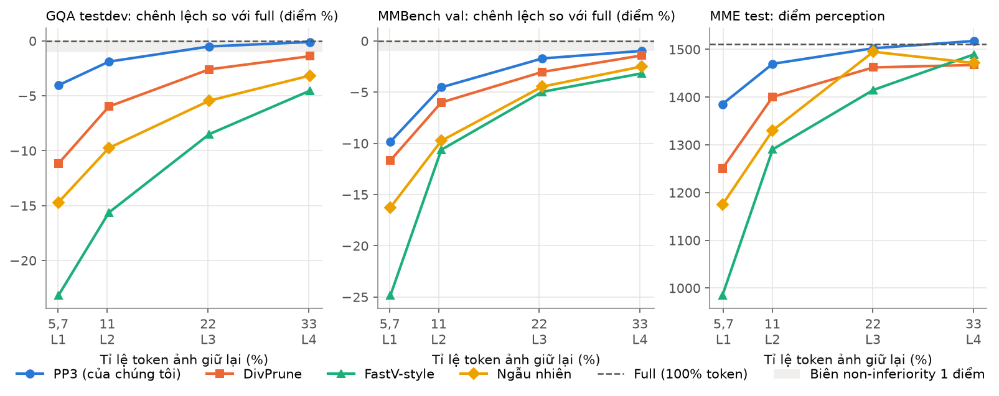
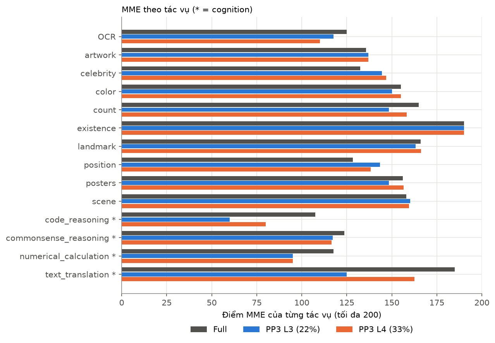
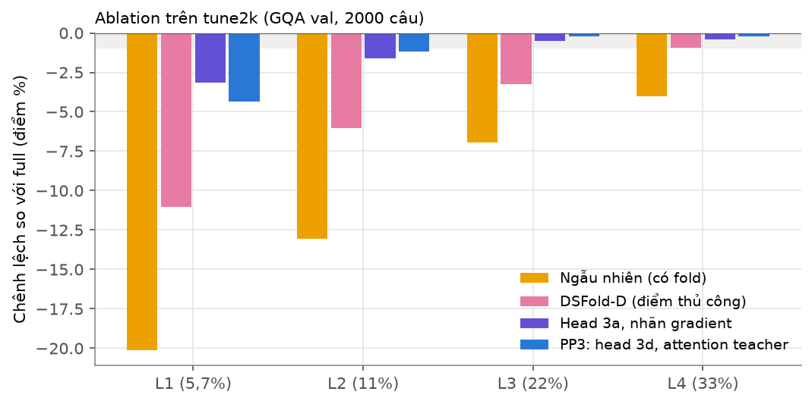
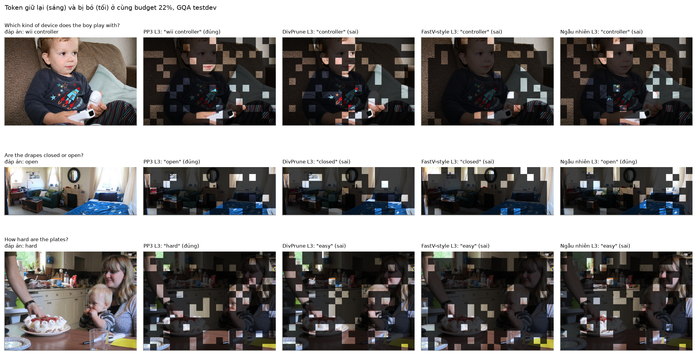
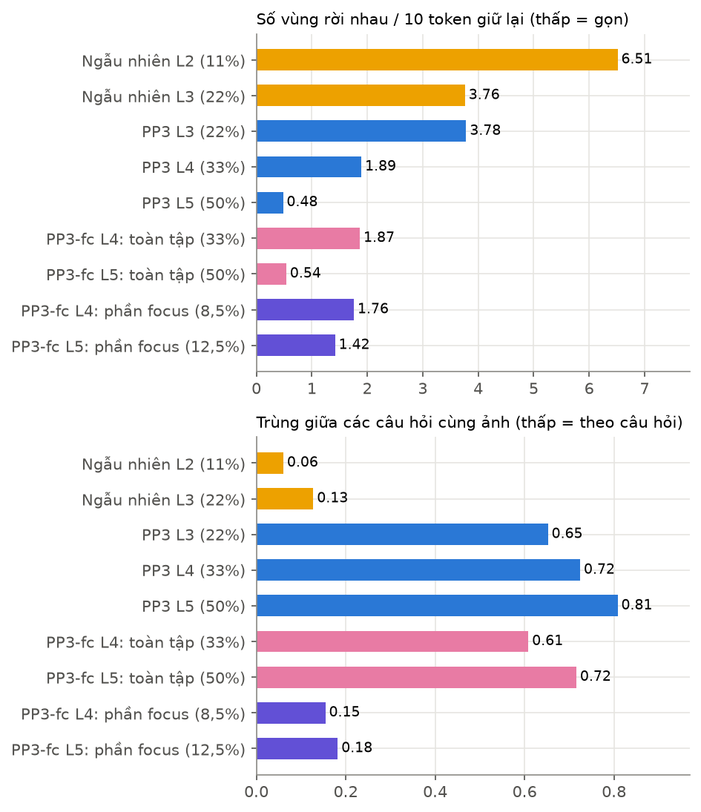
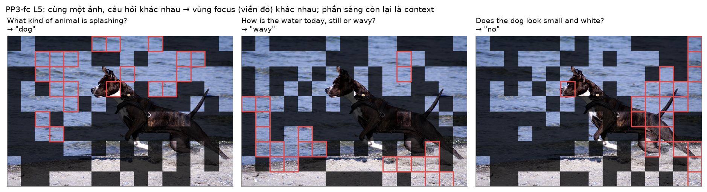
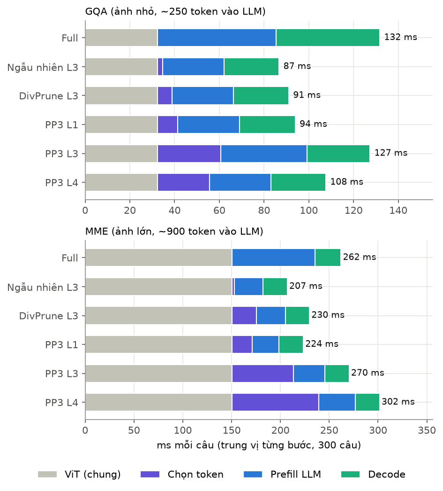

# PP3: Chọn token thị giác theo câu hỏi bằng bộ chấm điểm học từ attention cho mô hình thị giác–ngôn ngữ DeepStack

**Nguyễn Thiện Thanh, Nguyễn Trung Hiếu, Gia Bảo**

**Giảng viên hướng dẫn: Lê Phú Nguyên**

Bản tiếng Việt hoàn chỉnh, phiên bản 1 (04/11/2026). Mô hình: Qwen3-VL-2B-Instruct. Benchmark: GQA, MMBench, MME.

> **Bản này đã cũ.** Bản chính hiện tại là `docs/paper/latex/pp3_paper_vi.tex` (phiên bản 2, sửa theo phản biện):
> thêm CDPruner, viết lại phần tính mới, định nghĩa DSFold-D / chỉ số vùng / các head,
> khoảng tin cậy bootstrap cho MME, thời gian theo trung vị, và sửa các phát biểu quá mức.
> Dùng bản `.tex` khi trích số liệu.

---

## Tóm tắt

Mô hình thị giác–ngôn ngữ (VLM) dành phần lớn chuỗi đầu vào cho **token ảnh**,
và với một câu hỏi cụ thể thì nhiều token trong số đó là thừa. Bài báo này
nghiên cứu việc **chọn token ảnh** ở giữa bộ mã hóa ảnh (ViT) và mô hình ngôn
ngữ (LLM) của Qwen3-VL. Đây là mô hình có kiến trúc DeepStack: đặc trưng ảnh ở
nhiều mức được cộng vào ba lớp đầu của LLM.

Chúng tôi đề xuất **PP3**, gồm ba thành phần:

1. một **score head** nhỏ (1,99 triệu tham số) dự đoán, chỉ từ token ảnh và câu
   hỏi, mức độ mà LLM full-token sẽ chú ý tới từng token. Score head được huấn
   luyện bằng cách **chưng cất attention văn bản → ảnh** của chính mô hình;
2. thuật toán chọn token cân bằng **chất lượng và đa dạng** bằng quá trình
   điểm xác định (DPP);
3. bước **gộp DeepStack (fold)**: đặc trưng nhiều mức của mỗi token bị bỏ được
   gộp vào token giữ lại gần nó nhất.

Vì score head thay thế attention của LLM lúc suy luận, PP3 không cần bản đồ
attention và vẫn tương thích với các kernel attention nhanh (FlashAttention,
SDPA).

**Kết quả.** Ở cùng số token, PP3 tốt hơn chọn ngẫu nhiên, DivPrune và
FastV-style ở **mọi mức budget**, trên GQA, MMBench và MME perception.

- Giữ **22%** token ảnh: PP3 đạt non-inferiority so với mô hình full trên GQA
  testdev (−0,50 điểm, cận dưới một phía −0,88, biên 1 điểm).
- Giữ **33%**: PP3 chỉ mất 0,10 điểm trên GQA, và đạt điểm MME perception ngang
  mô hình full (1517,6 so với 1511,6).
- Budget càng nhỏ, PP3 thắng càng xa: với **5,7%** token, PP3 mất 4,0 điểm trên
  GQA testdev, trong khi DivPrune mất 11,2, ngẫu nhiên mất 14,7 và FastV-style
  mất 23,2.

Ngoài ra, chúng tôi chỉ ra rằng attention của LLM bị chi phối bởi các
**attention sink** không phụ thuộc câu hỏi. Chúng tôi đề xuất các chỉ số đánh
giá **hình dạng vùng** của tập token giữ lại, và một biến thể dễ diễn giải
(**PP3-fc**) cho vùng focus gọn và gắn với câu hỏi mà không mất độ chính xác
khi giữ 50% số token.

**Từ khóa:** mô hình thị giác–ngôn ngữ, cắt tỉa token ảnh, chưng cất attention,
quá trình điểm xác định, Qwen3-VL, DeepStack.

---

## 1. Giới thiệu

### 1.1 Bối cảnh

Một VLM như Qwen3-VL biến ảnh thành một dãy token rồi ghép với câu hỏi để LLM
xử lý. Số token ảnh tăng theo độ phân giải. Với Qwen3-VL-2B, mỗi token ứng với
một ô 32×32 pixel, nên:

- ảnh GQA nhỏ cho khoảng 64–1200 token;
- ảnh MME độ phân giải cao có thể lên tới **16 360 token**.

Chi phí của LLM (tính toán ở bước prefill, bộ nhớ KV cache) tăng theo độ dài
chuỗi. Trong khi đó, phần lớn câu hỏi chỉ liên quan tới một vài vùng nhỏ của
ảnh.

### 1.2 Hạn chế của các cách làm hiện có

Các phương pháp hiện có thuộc hai nhóm, mỗi nhóm có một nhược điểm:

1. **Cắt token bên trong LLM** dựa trên attention (FastV và các phương pháp
   sau). Cách này cần trọng số attention tường minh, nên không dùng được
   FlashAttention, và phải chạy vài lớp đầu với **đủ** token.
2. **Cắt token trước LLM nhưng không nhìn câu hỏi** (DivPrune, VisionZip, các
   phương pháp gộp token). Cách này chọn cùng một tập token cho mọi câu hỏi
   trên cùng một ảnh.

Qwen3-VL còn có thêm **DeepStack**: ba mức đặc trưng trung gian của ViT được
cộng vào hidden state ở lớp 0–2 của LLM, tại các vị trí token ảnh. Bỏ một token
nghĩa là bỏ nó khỏi cả bốn luồng (luồng chính và ba mức DeepStack). Theo hiểu
biết của chúng tôi, chưa có phương pháp nào xử lý trường hợp này.

### 1.3 Ý tưởng chính

LLM tự biết nó cần nhìn vào đâu: attention từ câu hỏi và câu trả lời tới các
token ảnh cho thấy điều đó. Tuy nhiên, đọc attention lúc suy luận vừa đắt vừa
quá muộn. Vì vậy PP3 **học trước** một mạng nhỏ để *đoán* bản đồ attention đó,
rồi dùng dự đoán này để chọn token **trước** khi LLM chạy.

### 1.4 Đóng góp

1. **Score head theo câu hỏi**, chạy trước LLM, được huấn luyện bằng chưng cất
   attention văn bản → ảnh của chính mô hình. Chúng tôi so sánh với nhãn
   saliency gradient: hai nguồn nhãn ngang nhau khi có 50k nhãn, và teacher tốt
   hơn khi chỉ có 10k nhãn.
2. **Chọn token bằng DPP kết hợp fold DeepStack** cho token bị bỏ, phù hợp với
   kiến trúc Qwen3-VL. Fold được giữ lại như một thành phần ablation; trên GQA
   nó trung tính.
3. **Phân tích teacher** (attention sink), **chỉ số vùng** cho tập token giữ lại
   (độ gọn, mức phụ thuộc câu hỏi), và **nhãn tương phản** cho biến thể dễ diễn
   giải PP3-fc.
4. **Quy trình đánh giá ghép cặp với non-inferiority**: so sánh trên cùng câu
   hỏi, kiểm định McNemar, cận dưới một phía, biên 1 điểm. Quy trình dùng tập
   phát triển, tập xác nhận và tập test tách biệt, trên ba benchmark không gộp
   chung.

---

## 2. Công trình liên quan

**Cắt token bên trong LLM.**
- FastV [1] nhận thấy attention tới token ảnh giảm mạnh sau lớp 2, nên cắt
  token có attention nhận được thấp từ lớp đó trở đi.
- SparseVLM [2] dùng các token văn bản liên quan để chấm điểm token ảnh.
- PyramidDrop [3] cắt dần theo từng giai đoạn của LLM.

Nhóm này cần attention tường minh và vẫn chạy các lớp đầu với đủ token.

**Cắt và gộp token trước LLM.**
- ToMe [4] gộp các token giống nhau.
- LLaVA-PruMerge [5] và VisionZip [6] chọn token dựa trên attention của bộ mã
  hóa ảnh (token [CLS]).
- DivPrune [7] chọn tập token đa dạng nhất theo tiêu chí max–min, không cần huấn
  luyện.

Nhóm này không phụ thuộc câu hỏi. PP3 cũng chọn token trước LLM, nhưng **theo
câu hỏi** và **có học**.

**DPP.** Quá trình điểm xác định [8] cân bằng chất lượng và đa dạng của một tập
con. Thuật toán MAP tham lam nhanh [9] được dùng rộng rãi trong gợi ý và tóm tắt.

**Attention sink.** Transformer dồn attention vào một số token ít mang thông tin
[10]. ViT cũng sinh ra các token "register" có chuẩn lớn ở nền ảnh [11]. Chúng
tôi quan sát hiện tượng này trong attention văn bản → ảnh của Qwen3-VL và đề
xuất cách loại bỏ nó (Mục 3.6).

**Mô hình và dữ liệu.**
- Qwen3-VL [12] dùng DeepStack [13] và M-RoPE.
- Benchmark: GQA [14], MMBench [15], MME [16].

---

## 3. Phương pháp



*Hình 1. Kiến trúc và luồng xử lý của PP3. (A) Suy luận cho mỗi câu hỏi: Qwen3-VL
đóng băng (xanh), đặc trưng không học (cam), score head học được (tím), chọn K
token bằng DPP, fold DeepStack, rồi LLM. (B) Huấn luyện score head bằng attention
teacher (offline). (C) Biến thể PP3-fc. Nguồn chỉnh sửa:
`architecture/pp3-dsfold-scorer/PP3-3d-attention-scorer.drawio`.*

### 3.1 Bài toán

Sau ViT và PatchMerger, ảnh cho ra:

- **N token** `v_i ∈ R^2048` trên lưới `H'×W'`;
- ba mức đặc trưng DeepStack `f_i^(l)`, `l = 1..3`, lấy từ ViT lớp 5, 11, 17.

Cho một tỉ lệ giữ `r`, bộ chọn phải giữ **K = ⌈r·N⌉** token.

LLM nhận:
- các `v` giữ lại, **đặt đúng vị trí M-RoPE gốc** `(t, h, w)` của chúng;
- các đặc trưng DeepStack của token giữ lại, sau khi fold.

Toàn bộ Qwen3-VL được **đóng băng**; chỉ score head được huấn luyện.

Các mức budget dùng chung cho mọi phương pháp:

| Mức | L1 | L2 | L3 | L4 | L5 |
|---|---|---|---|---|---|
| r | 1/18 | 1/9 | 2/9 | 1/3 | 1/2 |
| % token giữ | 5,6% | 11,1% | 22,2% | 33,3% | 50% |

**Ví dụ xuyên suốt.** Một ảnh GQA cho N = 160 token. Ở mức L3, K = ⌈160 × 2/9⌉ =
36 token được giữ; 124 token còn lại bị bỏ. N thay đổi theo kích thước ảnh: trên
tập phát triển, nhỏ nhất 64, trung vị 192, lớn nhất 1200.

### 3.2 S1 — Đặc trưng token (không học)

Mỗi token ảnh được mô tả bằng một vector **467 số**:

| Thành phần | Cách tính | Số chiều |
|---|---|---|
| Nội dung `v` | PCA cố định 2048 → 256 | 256 |
| 3 mức DeepStack | PCA cố định, mỗi mức 2048 → 64 | 192 |
| Điểm DSFold | `z_rel`: liên quan tới câu hỏi; `z_ms`: khác biệt giữa các mức | 2 |
| Vị trí | đặc trưng Fourier của tọa độ ô lưới | 16 |
| Budget | `log r` | 1 |

Câu hỏi được nhúng bằng bảng embedding (đóng băng) của LLM, rồi PCA 2048 → 256,
cho ra `w ∈ R^{N_q × 256}`. Các ma trận PCA được fit **một lần** trên 1000 ảnh
train. Nhờ PCA, kích thước dữ liệu huấn luyện giảm từ khoảng 220 GB xuống một
phần nhỏ.

### 3.3 S2 — Score head 3d (học)

Score head biến 467 số của mỗi token thành **một điểm `s_i`**. Thứ tự các khối
(chi tiết tham số ở Phụ lục A):

1. **Vào không gian ẩn:** Linear 467 → 256, cho ra `h ∈ R^{N×256}`.
2. **Self-attention giữa các token ảnh:** `h ← h + MHA(LN(h))`. Mỗi token biết
   ngữ cảnh của toàn ảnh, ví dụ "mình là một phần của cái điều khiển".
3. **Mã hóa câu hỏi:** cộng embedding vị trí của từ, qua một lớp Transformer
   encoder (4 head, FFN 512).
4. **Cross-attention token → từ:** `h ← h + MHA(LN(h), w, w)`. Mỗi token "đọc"
   câu hỏi.
5. **FFN** 256 → 1024 → 256, rồi LayerNorm.
6. **Điểm chung:** `a_i = Linear(h_i)`.
7. **Điểm khớp từ:** `b_i = logsumexp_w ⟨W_k h_i, W_q w_w⟩ / √256`. Đây là mức
   token khớp với từ phù hợp nhất trong câu hỏi; logsumexp là phiên bản mượt của
   max.
8. **Điểm cuối:** `s_i = a_i + b_i`.

Tổng cộng **1 993 153 tham số**, khoảng 0,09% kích thước Qwen3-VL-2B.

Chất lượng đưa vào DPP: **q̂_i = softplus(s_i) + 0,001**. Phép biến đổi này đảm
bảo chất lượng luôn dương.

### 3.4 Huấn luyện bằng attention teacher

**Bước 1 — Chạy mô hình full.** Với mỗi câu hỏi huấn luyện, Qwen3-VL được chạy
**đủ token** và trả lời bằng greedy decoding. Sau đó mô hình được chạy lại ở chế
độ **teacher-forced** trên chính câu trả lời của nó, với LLM dùng attention
*eager* (chỉ trong lượt này), để lấy được trọng số attention.

**Bước 2 — Đọc attention.** Hook gắn vào các lớp 8–19 (trong 28 lớp) của LLM.
Mỗi lớp trả ra ma trận `A ∈ R^{16 × L × L}` (16 head, chuỗi dài L). Ta chỉ lấy:

- **hàng** (vị trí đang đọc): vị trí sinh câu trả lời và vị trí các từ của câu
  hỏi;
- **cột** (vị trí được đọc): N vị trí token ảnh.

Kết quả là khối `[16 × R × N]`. Mỗi hàng được **chuẩn hóa lại** trên N cột, tức
chỉ xét "trong phần nhìn ảnh, nhìn vào đâu". Sau đó lấy trung bình theo head,
theo 12 lớp và theo hàng, được hai phân phối `p_ans` và `p_q`.

**Bước 3 — Nhãn.** `p = 0,5 · p_ans + 0,5 · p_q`: một **bản đồ nhiệt** gồm N số
không âm, tổng bằng 1.

Lưu ý: attention ở đây **không phải** một embedding. Embedding là một vector 2048
số cho mỗi token. Nhãn teacher là **một số cho mỗi token ảnh**.

**Hàm mất mát:** cross-entropy giữa `p` và `softmax(s)` (nhiệt độ 1).

**Cấu hình huấn luyện:**
- dữ liệu: 50 000 câu GQA train balanced;
- tối ưu: AdamW, lr 3·10⁻⁴ với cosine schedule, weight decay 0,01;
- batch 16, 20 epoch, early stopping với patience 3 trên các ảnh để riêng;
- recall top-K so với teacher trên tập kiểm tra: **0,836**.

**Vì sao dùng teacher?** Teacher cho biết LLM *thực sự* dùng token nào. Học trước
bản đồ đó giúp lúc suy luận không cần đọc attention trong LLM.

**Giới hạn của cách làm này:** vì score head bắt chước mô hình full, trần kỳ vọng
của nó là ngang mô hình full, không vượt qua.

**Nguồn nhãn thay thế (head 3a):** saliency gradient × input, cần một lượt
backward cho mỗi mẫu. Mục 5.4 so sánh hai nguồn nhãn.

### 3.5 S3 — Chọn K token bằng DPP và S4 — fold DeepStack

**DPP.** Kernel được định nghĩa là

`L = diag(q̂) · S · diag(q̂)`, với `S_ij = cos(v_i, v_j)`.

Thuật toán MAP tham lam [9] mỗi bước thêm token làm `log det(L_chọn)` tăng nhiều
nhất. Nhờ vậy, DPP ưu tiên token **điểm cao** nhưng **khác nhau**. Ví dụ, nó
không lấy cả 36 token từ cùng một mảng trời.

**Fold DeepStack.** Mỗi token bị bỏ `d` được gán cho token giữ lại gần nhất:

`a(d) = argmax_k [cos(v_d, v_k) − λ · dist(d, k) / diag]`.

Với mỗi mức DeepStack `l`, đặc trưng của token giữ lại `k` được cập nhật:

`f'_k = norm-match( f_k + γ · Σ_{d ∈ A(k)} w_dk · f_d )`, với `w_dk = softmax_d( cos(v_d, v_k) / τ )`.

Tham số: λ = 0,5; γ = 0,5; τ = 0,1. Phép `norm-match` giữ nguyên chuẩn ban đầu
của `f_k`. Luồng chính `v` **không bị thay đổi**.

### 3.6 Biến thể dễ diễn giải PP3-fc (focus + context)

**Quan sát: attention sink.** Teacher, và cả head bắt chước nó, dồn phần lớn
attention vào các token nền (trời, tường) cho **mọi** câu hỏi trên cùng một ảnh.
Hệ quả là tập token giữ lại của các câu hỏi khác nhau trên cùng ảnh trùng nhau
rất nhiều: Jaccard 0,65 (L3) và 0,72 (L4), so với 0,13 và 0,20 khi chọn ngẫu
nhiên (Hình 6).

**Nhãn tương phản.** Với một câu hỏi trên một ảnh có các câu hỏi khác,

`t ∝ max(0, p − trung bình p của các câu hỏi khác trên cùng ảnh)`.

Nhãn này bỏ phần chung của ảnh và giữ lại phần riêng của câu hỏi. 98,6% mẫu
huấn luyện có câu hỏi "anh em" như vậy. Một head 3d thứ hai được huấn luyện
trên `t`.

**Ví dụ số.** Trên một ảnh có 4 token, giả sử:

| | trời | TV | remote | sàn |
|---|---|---|---|---|
| `p` (câu hỏi "remote ở đâu?") | 0,40 | 0,15 | 0,40 | 0,05 |
| trung bình `p` các câu hỏi khác | 0,45 | 0,30 | 0,10 | 0,15 |
| `max(0, chênh lệch)` | 0 | 0 | 0,30 | 0 |
| `t` sau chuẩn hóa | 0 | 0 | **1** | 0 |

Token "trời" có attention cao nhưng là sink chung, nên nhãn tương phản loại bỏ
nó.

**Chọn token.** K được chia thành hai phần:

- **Focus** (ρ = 25% của K): mọc vùng liên thông trên điểm tương phản đã chuẩn
  hóa z, với thưởng β = 1 cho mỗi láng giềng 8 hướng đã được chọn;
- **Context** (75% còn lại): DPP trên các token chưa chọn, dùng chất lượng q̂ của
  head chính.

### 3.7 Vì sao PP3 tương thích với attention nhanh

FastV và các phương pháp tương tự phải đọc attention bên trong LLM. Chế độ eager
tạo ra ma trận `16 × L × L` cho mỗi lớp. Với ảnh MME 13 862 token, ma trận này
chiếm khoảng **6 GB** ở bf16 và khoảng 12 GB khi softmax ở float32. Trong quá
trình thực nghiệm, baseline FastV-style của chúng tôi đã bị tràn bộ nhớ ở đúng
ảnh này và phải được viết lại theo từng khối hàng.

PP3 chỉ cần attention lúc **huấn luyện** (offline, ảnh GQA nhỏ). Lúc suy luận, LLM
chạy bình thường với SDPA/FlashAttention trên K token.

---

## 4. Thiết lập thực nghiệm

**Mô hình.** Qwen3-VL-2B-Instruct, bf16, greedy decoding, tối đa 32 token mới.

**Phần cứng và phần mềm.** Một GPU NVIDIA GeForce RTX 5060 Ti 16 GB, CUDA 13.0,
PyTorch 2.14.1, Transformers 5.19.0, Python 3.12.

**Dữ liệu.**

| Vai trò | Tập | Số câu |
|---|---|---|
| Huấn luyện score head | GQA train balanced | 50 000 |
| Phát triển (chọn cấu hình) | tune2k: GQA val balanced | 2000 |
| Xác nhận (sau khi chốt cấu hình) | gqa_val_confirm: GQA val, không trùng tune2k | 4890 |
| Test | GQA testdev balanced | 12 578 |
| Test | MMBench validation | 4329 |
| Test | MME test | 2374 |

GQA test và MMBench test không có nhãn công khai, nên không được dùng để báo
cáo.

**Baseline** (cùng giao diện chọn token, cùng K):
- **Ngẫu nhiên:** chọn đều ngẫu nhiên, có fold;
- **DivPrune** [7]: max–min đa dạng theo cosine trên `v`, không fold, đúng như
  bản gốc;
- **FastV-style** [1]: top-K token theo attention nhận được ở lớp 2 của LLM trong
  prefill full-token, áp dụng tại đầu vào LLM, không fold. Đây không phải FastV
  gốc, vốn cắt bên trong LLM; xem Mục 7.

**Giao thức đánh giá.**
- Mọi cấu hình được giải mã từ **cùng một lượt ViT** với lượt full-token.
- So sánh **ghép cặp** với mô hình full trên cùng câu hỏi: kiểm định McNemar
  chính xác, khoảng tin cậy 95%, và cận dưới một phía 95% so với biên
  non-inferiority **1 điểm**.
- GQA và MMBench báo cáo accuracy. MME báo cáo **điểm perception** (tối đa 2000)
  và **cognition** (tối đa 800); đây là điểm, không phải phần trăm.
- **Không lấy trung bình** giữa các benchmark.
- Cấu hình được chọn trên tune2k, xác nhận trên gqa_val_confirm, rồi chạy **một
  lần** trên tập test.

---

## 5. Kết quả

### 5.1 Kết quả chính trên tập test

Bảng 1 cho chênh lệch so với mô hình full (điểm %) kèm khoảng tin cậy 95% ghép
cặp cho GQA và MMB, và điểm tuyệt đối cho MME.

| Mức (% token) | Phương pháp | GQA testdev | MMBench val | MME perc. | MME cogn. |
|---|---|---|---|---|---|
| 100% | **Full** | 59,18% | 83,90% | 1511,6 | 533,6 |
| L1 (5,7%) | Ngẫu nhiên | −14,71 [−15,57; −13,85] | −16,26 [−17,55; −14,97] | 1174,4 | 294,3 |
| | DivPrune | −11,18 [−12,00; −10,36] | −11,67 [−12,83; −10,50] | 1250,2 | 289,3 |
| | FastV-style | −23,19 [−24,13; −22,25] | −24,86 [−26,32; −23,39] | 984,3 | 304,3 |
| | **PP3** | **−4,04** [−4,67; −3,41] | **−9,84** [−10,98; −8,70] | **1385,3** | **323,2** |
| L2 (11%) | Ngẫu nhiên | −9,75 [−10,52; −8,97] | −9,75 [−10,87; −8,62] | 1330,3 | 337,1 |
| | DivPrune | −5,97 [−6,67; −5,27] | −6,01 [−6,99; −5,02] | 1400,5 | 324,6 |
| | FastV-style | −15,63 [−16,51; −14,76] | −10,63 [−11,77; −9,48] | 1290,5 | 331,1 |
| | **PP3** | **−1,88** [−2,43; −1,34] | **−4,53** [−5,43; −3,63] | **1469,8** | **358,9** |
| L3 (22%) | Ngẫu nhiên | −5,44 [−6,11; −4,77] | −4,46 [−5,33; −3,58] | 1495,0 | 333,9 |
| | DivPrune | −2,58 [−3,16; −2,00] | −3,03 [−3,83; −2,22] | 1462,2 | 389,3 |
| | FastV-style | −8,48 [−9,22; −7,75] | −4,97 [−5,84; −4,10] | 1415,0 | **426,8** |
| | **PP3** | **−0,50** [−0,96; −0,05] | **−1,71** [−2,40; −1,02] | **1502,4** | 397,1 |
| L4 (33%) | Ngẫu nhiên | −3,16 [−3,75; −2,57] | −2,49 [−3,25; −1,74] | 1471,5 | 440,0 |
| | DivPrune | −1,39 [−1,90; −0,88] | −1,41 [−2,08; −0,73] | 1467,4 | 445,4 |
| | FastV-style | −4,53 [−5,14; −3,92] | −3,16 [−3,89; −2,44] | 1489,4 | **454,6** |
| | **PP3** | **−0,10** [−0,48; +0,29] | **−0,97** [−1,58; −0,36] | **1517,6** | 453,9 |
| L5 (50%) | PP3-fc (ρ = 25%) | −0,15 [−0,46; +0,16] | −0,21 [−0,69; +0,28] | 1533,7 | 492,5 |

*Bảng 1. Kết quả trên tập test. Chữ đậm là tốt nhất trong cùng mức budget.*



*Hình 2. Chất lượng theo tỉ lệ token giữ lại. Dải xám là biên non-inferiority 1
điểm. PP3 (xanh dương) nằm trên mọi baseline ở mọi mức.*

**Nhận xét.**

1. **PP3 tốt nhất ở mọi mức** trên GQA, MMBench và MME perception. So với
   baseline tốt nhất (DivPrune) trên GQA, PP3 hơn **+7,14** điểm ở L1, +4,09 ở
   L2, +2,08 ở L3 và +1,29 ở L4. Khoảng cách tăng khi budget giảm, đúng ở chỗ
   chọn token khó nhất.
2. **Non-inferiority** (cận dưới một phía phải lớn hơn −1):

   | | GQA | MMBench |
   |---|---|---|
   | PP3 L2 | ✗ (cận dưới −2,34) | ✗ |
   | PP3 L3 | ✓ (−0,88) | ✗ |
   | PP3 L4 | ✓ (−0,42) | ✗ (−1,48) |
   | PP3-fc L5 | ✓ (−0,41) | ✓ (−0,62) |

   Kết quả GQA khớp với tập phát triển và tập xác nhận (Mục 5.3), nơi L3 và L4
   cũng đạt.
3. **MME perception** của PP3 ở L4 (1517,6) và của PP3-fc ở L5 (1533,7) **cao
   hơn** mô hình full (1511,6), dù chỉ dùng 1/3 và 1/2 số token.
4. **Tổng quát hóa sang benchmark khác.** Score head chỉ được huấn luyện trên GQA,
   nhưng vẫn dẫn đầu trên MMBench (câu hỏi trắc nghiệm đa lĩnh vực) và MME.
5. **MME cognition** giảm với **mọi** phương pháp. FastV-style dẫn ở L3; ở L4 nó
   ngang PP3. Mục 5.2 phân tích nguyên nhân.

### 5.2 Phân tích MME theo từng tác vụ



*Hình 3. Điểm MME theo từng tác vụ (tối đa 200). Dấu * đánh dấu tác vụ
cognition.*

Phần điểm bị mất tập trung ở các tác vụ **phải đọc chữ trong ảnh**:

| Tác vụ | Full | PP3 L3 | PP3 L4 |
|---|---|---|---|
| code_reasoning * | 108 | 60 | 80 |
| text_translation * | 185 | 125 | 162 |
| numerical_calculation * | 118 | 95 | 95 |
| OCR | 125 | 118 | 110 |
| celebrity | 132 | 144 | 147 |
| position | 128 | 143 | 138 |

Chữ nhỏ trải trên rất nhiều token, nên bỏ bớt token là mất ký tự. Thêm vào đó,
teacher học trên GQA (câu hỏi về vật thể) nên không ưu tiên vùng chữ. Ngược
lại, ở celebrity và position, PP3 **cao hơn** mô hình full: bỏ nền thừa giúp mô
hình tập trung vào đối tượng.

Lưu ý về độ nhiễu: mỗi tác vụ cognition chỉ có 40 câu trên 20 ảnh, nên sai một
ảnh đã làm lệch 10–20 điểm.

### 5.3 Kết quả phát triển và xác nhận (GQA val)

**tune2k** (2000 câu, full 68,90%), chênh lệch so với full:

| Mức | Ngẫu nhiên | DivPrune | FastV-style | PP3 |
|---|---|---|---|---|
| L1 | −20,10 | −16,55 | −30,40 | **−4,35** |
| L2 | −13,05 | −7,90 | −17,85 | **−1,20** |
| L3 | −6,95 | −3,35 | −7,70 | **−0,20** |
| L4 | −4,00 | −1,45 | −4,35 | **−0,20** |

**gqa_val_confirm** (4890 câu, không trùng tune2k, full 69,55%; cấu hình đã được
chốt trước khi chấm tập này):

| Mức | Ngẫu nhiên | DivPrune | FastV-style | PP3 | Cận dưới một phía của PP3 |
|---|---|---|---|---|---|
| L1 | −18,69 | −14,46 | −29,08 | **−4,62** | −5,45 |
| L2 | | | | **−1,62** | −2,30 |
| L3 | −5,81 | −3,11 | −7,03 | **−0,18** | **−0,73** ✓ |
| L4 | | | | **+0,04** | **−0,43** ✓ |

So sánh đối đầu (McNemar, cùng câu hỏi), PP3 hơn DivPrune **+9,84** [+8,55;
+11,12] ở L1 và +2,92 [+2,09; +3,76] ở L3, hơn FastV-style +6,85 [+5,76; +7,94] ở
L3, tất cả với p < 0,001.

Ba tập dữ liệu độc lập (tune2k, confirm, testdev) cho cùng một thứ hạng và cùng
một kết luận.

### 5.4 Ablation — thành phần nào quan trọng



*Hình 4. Ablation trên tune2k. Dải xám là biên 1 điểm.*

| Bước | L1 | L2 | L3 | L4 |
|---|---|---|---|---|
| Ngẫu nhiên (có fold) | −20,10 | −13,05 | −6,95 | −4,00 |
| DSFold-D: điểm thủ công, không học | −11,05 | −6,05 | −3,25 | −0,95 |
| Head 3a, nhãn gradient (50k) | −3,15 | −1,60 | −0,50 | −0,40 |
| Head 3c: cross-attention, nhãn gradient | | | −1,00 | −0,70 |
| Head 3d, attention teacher (10k) | | | −0,25 | −0,20 |
| **Head 3d, attention teacher (50k) = PP3** | −4,35 | −1,20 | −0,20 | −0,20 |
| PP3 không fold (γ = 0) | | −1,25 | −0,25 | +0,15 |

- **Điểm chất lượng học được là bước tiến lớn nhất.** Từ DSFold-D sang head 3a,
  chất lượng tăng +7,90 (L1), +4,45 (L2), +2,75 (L3) và +0,55 (L4) điểm.
- **Ngay cả DSFold-D không học** cũng thắng DivPrune ở mọi mức.
- **Nguồn nhãn.** Với 10k nhãn, attention teacher hơn nhãn gradient +1,70 điểm ở
  L3 (p = 0,003). Với 50k nhãn hai nguồn tương đương: chênh −1,20 ở L1 (p =
  0,15), +0,40 ở L2, +0,30 ở L3 và +0,20 ở L4. Teacher **tiết kiệm nhãn hơn** và
  không cần lượt backward, nhưng không chính xác hơn khi có 50k nhãn.
- **Fold DeepStack** không tạo khác biệt đo được trên GQA.

### 5.5 Trực quan hóa token được chọn



*Hình 5. Token giữ lại (sáng) và bị bỏ (tối) ở cùng budget 22% trên GQA testdev.
Đây là các câu mà mô hình full và PP3 trả lời đúng còn DivPrune và FastV-style
trả lời sai.*

- **Câu 1** ("Which kind of device does the boy play with?"): PP3 giữ cụm token ở
  tay và cái điều khiển, nên trả lời chính xác "wii controller". Các phương pháp
  khác chỉ thấy đủ để nói "controller".
- **Câu 2** ("Are the drapes closed or open?"): PP3 giữ các token ở cửa sổ và
  rèm. DivPrune rải token đều khắp phòng; FastV-style dồn token vào vùng trần và
  tường sáng.
- Nhìn chung, **FastV-style** tập trung vào các vùng sáng đồng nhất (tường, gối).
  Đây là biểu hiện của attention sink ở lớp nông.

### 5.6 Hình dạng vùng và mức phụ thuộc câu hỏi



*Hình 6. Trái: số vùng rời nhau trên 10 token giữ lại (thấp = gọn). Phải: mức
trùng (Jaccard) giữa tập giữ lại của các câu hỏi khác nhau trên cùng ảnh (thấp
= phụ thuộc câu hỏi). tune2k.*

- **PP3 gắn với ảnh nhiều hơn với câu hỏi:** mức trùng 0,65–0,72, gấp khoảng 5
  lần chọn ngẫu nhiên. Đây là dấu vết của attention sink mà score head học từ
  teacher.
- **Phần focus của PP3-fc** vừa **gọn** (1,4–1,8 vùng trên 10 token) vừa **theo
  câu hỏi** (mức trùng 0,15–0,18, gần mức ngẫu nhiên ở cùng số token).
- Độ chính xác không bị ảnh hưởng: ở L5, PP3-fc đạt 68,85% so với 68,70% của PP3.



*Hình 7. PP3-fc ở L5: cùng một ảnh, các câu hỏi khác nhau cho vùng focus (viền
đỏ) khác nhau. Câu "con vật nào đang té nước" tập trung vào nước bắn quanh con
chó; câu "mặt nước phẳng hay gợn sóng" tập trung vào mặt nước; câu "con chó có
nhỏ và trắng không" tập trung vào thân con chó.*

Trên tune2k, đánh đổi giữa phần focus và độ chính xác ở L4 như sau: focus 0 /
25 / 40 / 55% cho chênh lệch −0,20 / −0,35 / −0,60 / −1,05 điểm. Ở L5, focus không
làm mất gì (cả hai đều −0,05).

### 5.7 Câu hỏi có/không

Câu hỏi yes/no (566 trên 2000 câu, nhận diện từ văn bản câu hỏi) vẫn thấp hơn
full 0,7–1,8 điểm ở mọi budget tới 50%, dù có hay không có fold.

Phần lớn lỗi là câu có đáp án **"no"** mà mô hình sau khi cắt token lại trả lời
"yes". Ví dụ ở L4: 14 câu "no" bị mất và 1 câu được thêm; 3 câu "yes" bị mất và 6
câu được thêm. Chọn ngẫu nhiên thì ngược lại, chủ yếu mất câu "yes" (24 câu).
Một giải thích hợp lý: khi chỉ giữ token liên quan tới đối tượng được hỏi, mô
hình thiếu bằng chứng để phủ định.

Một budget riêng theo dạng câu hỏi không cải thiện quá mức nhiễu.

### 5.8 Hiệu năng

Phép đo được chạy riêng, một tiến trình duy nhất trên GPU, mỗi tập 300 câu. ViT
không được tính vì giống nhau cho mọi phương pháp.



*Hình 8. Thời gian mỗi câu chia theo bước chọn token, prefill và decode. Dấu * :
thời gian FastV-style chưa tính lượt chạy thêm 2 lớp LLM để lấy attention, nên
thấp hơn thực tế.*

| | GQA: token vào LLM | GQA: tổng (ms) | MME: token vào LLM | MME: tổng (ms) |
|---|---|---|---|---|
| Full | 249 | 102,6 | 912 | 119,4 |
| DivPrune L3 | 75 | 67,3 | 230 | 81,9 |
| PP3 L1 | 38 | **69,5 (−32%)** | 84 | **74,4 (−38%)** |
| PP3 L3 | 75 | 104,6 | 230 | 125,7 |
| PP3 L4 | 100 | 85,3 | 327 | 155,0 |

- **Bản thân việc cắt token có lợi.** Với bất kỳ bộ chọn nào, prefill giảm từ 51
  xuống khoảng 28 ms (GQA) và từ 88 xuống 28–39 ms (MME). Decode giảm từ 51,5
  xuống khoảng 30 ms nhờ KV cache ngắn hơn. Trên toàn bộ MME test (trung bình
  1790 token), prefill giảm từ 396 xuống 97 ms ở L3.
- **Bộ chọn của PP3 tốn 10–90 ms**, tăng theo K và N (score head cộng DPP tham
  lam). Kết quả là PP3 nhanh hơn full rõ ở L1, ngang full ở L3/L4 trên GQA, và
  chậm hơn full ở L3/L4 trên MME.
- **Bộ nhớ đỉnh** gần như không đổi (lệch dưới 0,3 GB), vì trọng số mô hình 2B
  chiếm phần lớn.

Vì vậy PP3 được trình bày là phương pháp **chất lượng cao ở cùng budget**. Số
token vào LLM giảm 71–76% ở L3 là có thật, nhưng để biến nó thành tăng tốc thực
tế cần một bộ chọn nhanh hơn (Mục 8).

---

## 6. Thảo luận

**Vì sao học từ attention lại hiệu quả?** DivPrune chỉ nhìn ảnh, FastV-style chỉ
nhìn một lớp nông. Score head kết hợp ba nguồn: nội dung token (self-attention
toàn ảnh), câu hỏi (cross-attention), và tín hiệu về những gì LLM *thật sự dùng*
ở các lớp giữa (8–19). DPP sau đó tránh việc chọn nhiều token trùng lặp.

**Vì sao FastV-style kém?** Ở lớp 2, attention tới ảnh dồn vào các token sink
(vùng sáng, nền đồng nhất). Chọn theo tín hiệu này còn tệ hơn chọn ngẫu nhiên ở
mọi budget. Trái lại, teacher của PP3 lấy trung bình từ lớp 8–19 và chuẩn hóa
trên token ảnh, nên ít bị ảnh hưởng hơn. Nó vẫn chưa sạch hoàn toàn, như Mục 5.6
cho thấy.

**Có vượt được mô hình full không?** Trên GQA và MMBench thì không. Đây là điều
dự kiến, vì score head bắt chước mô hình full. Trên MME perception, việc bỏ token
nền thừa lại giúp tăng điểm (celebrity, position).

---

## 7. Hạn chế

1. **Một kích thước mô hình** (2B) và **một seed** cho mỗi cấu hình.
2. **Chưa tăng tốc thực tế.** Bộ chọn chưa được tối ưu, và DPP tham lam tăng
   theo bình phương N.
3. **Trần là ngang mô hình full**, vì teacher bắt chước chính mô hình full.
4. **Ảnh nhiều chữ** (MME cognition, OCR) mất 80–140 điểm MME với mọi phương
   pháp. Score head chỉ được huấn luyện trên GQA.
5. **MMBench ở 33% token** thấp hơn full 0,97 điểm và chưa đạt biên
   non-inferiority.
6. **Attention sink:** teacher kế thừa thiên lệch của LLM. PP3-fc giảm được, nhưng
   chỉ cho phần focus.
7. **Câu yes/no** với đáp án "no" vẫn thấp hơn mô hình full.
8. **Baseline FastV-style** cắt ở đầu vào LLM bằng attention lớp 2, không phải
   FastV gốc cắt bên trong LLM. Các baseline mạnh hơn (VisionZip, SparseVLM,
   PyramidDrop) chưa được chạy.

---

## 8. Kết luận và hướng phát triển

Một score head 2 triệu tham số, nhận biết câu hỏi, được chưng cất từ attention
văn bản → ảnh của chính LLM và kết hợp với chọn token bằng DPP, là một bộ chọn
token ảnh mạnh cho mô hình DeepStack Qwen3-VL-2B.

- Ở cùng budget, PP3 thắng chọn ngẫu nhiên, DivPrune và FastV-style trên GQA,
  MMBench và MME perception, với khoảng cách lớn nhất ở budget nhỏ nhất.
- Với 22–33% số token, PP3 đạt non-inferiority so với mô hình full trên GQA và
  giữ nguyên điểm MME perception.

**Hướng phát triển (phiên bản 2):**
1. Mở rộng sang Qwen3-VL-4B; nhiều seed.
2. Bộ chọn nhanh hơn: DPP trên tập ứng viên top-k, hoặc cài đặt DPP bằng kernel
   GPU.
3. Dữ liệu teacher đa dạng hơn, có ảnh nhiều chữ và tài liệu.
4. Mục tiêu huấn luyện có thể **vượt** mô hình full thay vì chỉ bắt chước:
   teacher trên đáp án đúng, hoặc chỉ dùng các mẫu mô hình full trả lời đúng.
5. So sánh với FastV gốc, VisionZip, SparseVLM và PyramidDrop.

---

## Tài liệu tham khảo

Cần kiểm tra lại năm và nơi công bố trước khi nộp.

1. L. Chen et al. *An Image is Worth 1/2 Tokens After Layer 2: Plug-and-Play
   Inference Acceleration for Large Vision-Language Models* (FastV). ECCV 2024.
2. Y. Zhang et al. *SparseVLM: Visual Token Sparsification for Efficient
   Vision-Language Model Inference*. ICML 2025.
3. L. Xing et al. *PyramidDrop: Accelerating Your Large Vision-Language Models
   via Pyramid Visual Redundancy Reduction*. CVPR 2025.
4. D. Bolya et al. *Token Merging: Your ViT But Faster* (ToMe). ICLR 2023.
5. Y. Shang et al. *LLaVA-PruMerge: Adaptive Token Reduction for Efficient Large
   Multimodal Models*. 2024.
6. S. Yang et al. *VisionZip: Longer is Better but Not Necessary in Vision
   Language Models*. CVPR 2025.
7. S. R. Alvar et al. *DivPrune: Diversity-based Visual Token Pruning for Large
   Multimodal Models*. CVPR 2025.
8. A. Kulesza, B. Taskar. *Determinantal Point Processes for Machine Learning*.
   Foundations and Trends in ML, 2012.
9. L. Chen, G. Zhang, H. Zhou. *Fast Greedy MAP Inference for Determinantal
   Point Process to Improve Recommendation Diversity*. NeurIPS 2018.
10. G. Xiao et al. *Efficient Streaming Language Models with Attention Sinks*.
    ICLR 2024.
11. T. Darcet et al. *Vision Transformers Need Registers*. ICLR 2024.
12. Qwen Team. *Qwen3-VL Technical Report*. 2025.
13. L. Meng et al. *DeepStack: Deeply Stacking Visual Tokens is Surprisingly
    Simple and Effective for LMMs*. NeurIPS 2024.
14. D. A. Hudson, C. D. Manning. *GQA: A New Dataset for Real-World Visual
    Reasoning and Compositional Question Answering*. CVPR 2019.
15. Y. Liu et al. *MMBench: Is Your Multi-modal Model an All-around Player?*
    ECCV 2024.
16. C. Fu et al. *MME: A Comprehensive Evaluation Benchmark for Multimodal Large
    Language Models*. 2023.

---

## Phụ lục A. Chi tiết score head 3d

Ví dụ với N = 160 token ảnh và N_q từ câu hỏi.

| # | Khối | Phép tính | Đầu ra | Tham số |
|---|---|---|---|---|
| 1 | Chiếu `v` | Linear 256 → 256 | 160 × 256 | 65 792 |
| 2 | Chiếu DeepStack | 3 × Linear 64 → 64 | 3 × 160 × 64 | 12 480 |
| 3 | Ghép `u_i` | [v 256; 3 mức 192; z_rel, z_ms 2; vị trí 16; log r 1] | 160 × 467 | 0 |
| 4 | Chiếu từ câu hỏi | Linear 256 → 256 | N_q × 256 | 65 792 |
| 5 | Vào không gian token | Linear 467 → 256 | 160 × 256 | 119 808 |
| 6 | Self-attention token ảnh | `h + MHA(LN(h))` | 160 × 256 | 263 680 |
| 7 | Vị trí từ | Embedding(64, 256) | N_q × 256 | 16 384 |
| 8 | Mã hóa câu hỏi | 1 lớp Transformer encoder (4 head, FFN 512) | N_q × 256 | 527 104 |
| 9 | Cross-attention token → từ | `h + MHA(LN(h), w, w)` | 160 × 256 | 263 680 |
| 10 | FFN | 256 → 1024 → 256, GELU | 160 × 256 | 526 080 |
| 11 | LayerNorm cuối | | 160 × 256 | 512 |
| 12 | Điểm chung `a_i` | Linear 256 → 1 | 160 | 257 |
| 13 | Điểm khớp từ `R_iw` | `⟨W_k h_i, W_q w_w⟩ / √256` | 160 × N_q | 131 584 |
| 14 | Gộp theo từ `b_i` | logsumexp theo w | 160 | 0 |
| 15 | Điểm cuối | `s_i = a_i + b_i` | 160 | — |
| | **Tổng** | | | **1 993 153** |

So sánh: head 3a có 777 409 tham số; head 3c có 1 318 081 tham số.

## Phụ lục B. Tái lập kết quả

Toàn bộ lệnh nằm trong `docs/research/pp3-runbook.md`. Các bước chính:

```powershell
uv run python scripts/pp3/run_diagnostics.py --method-config configs/methods/pp3_scorer_attn50k.yaml --tag 3d_attn50k --source gqa_testdev_balanced --split all --prefix final --only full random_L1 divprune_L1 fastv_L1 3d_attn50k_L1
```

```powershell
uv run python scripts/pp3/final_report.py --runs random_L1 divprune_L1 fastv_L1 3d_attn50k_L1 --output outputs/reports/pp3_final/tables.md
```

```powershell
uv run python scripts/pp3/paper_figures.py
```

```powershell
uv run python scripts/pp3/make_architecture_drawio.py
```

Dự đoán của mọi cấu hình được lưu ở `outputs/{none,pp3_scorer}/runs/<prefix>_<run>_<dataset>/`,
kèm `run_meta.json` ghi cấu hình, checkpoint, phiên bản thư viện và GPU.
