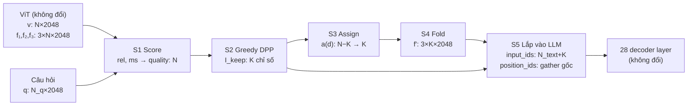

# Cách 1 — DSFold không huấn luyện (toán thuần, r cố định)

- Trạng thái: Đề xuất
- Vai trò: **bắt buộc**, là nền móng cho cách 2–4
- Bao nhiêu token: **r cố định**, 7 mức · Token nào: **công thức toán**
- Ký hiệu, cách lắp vào model, công thức chi phí, giao thức đánh giá: xem
  [`README.md`](README.md) mục 2–9. File này chỉ mô tả phần riêng của cách 1.
- Ánh xạ lên sơ đồ (M1–M8): [`../dsfold-method-proposal.md`](../dsfold-method-proposal.md) mục 5

## 0. Tóm tắt nhanh

**Một câu:** sau khi ViT chạy xong, chọn K token vừa **đa dạng** vừa **liên
quan tới câu hỏi** bằng DPP; token bị bỏ không mất hẳn mà được **gộp vào kênh
DeepStack** của token giữ lại gần nó; sau đó đưa K token vào LLM với **toạ độ
M-RoPE gốc**.

**Không huấn luyện gì.** Chỉ có 5 siêu tham số (α, β, λ, γ, τ), chỉnh một lần
trên GQA val rồi khoá lại.

### 0.1 Các mức ngân sách dùng trong cách này

Cách 1 chạy **riêng từng mức**, cùng một r cho mọi ảnh:

| Mức | L7 | L6 | L5 | L4 | L3 | L2 | L1 |
| --- | ---: | ---: | ---: | ---: | ---: | ---: | ---: |
| **r** | **100%** | **75%** | **50%** | **33,3%** | **22,2%** | **11,1%** | **5,6%** |
| K của ảnh GQA trung vị (N = 260) | 260 | 195 | 130 | 87 | 58 | 29 | 15 |
| K của ảnh MMBench trung vị (N = 176) | 176 | 132 | 88 | 59 | 40 | 20 | 10 |
| K của ảnh MME trung vị (N = 384) | 384 | 288 | 192 | 128 | 86 | 43 | 22 |

Số liệu đầy đủ (trung bình, P95, `N_total′`) nằm ở README mục 6.2.

### 0.2 Luồng dữ liệu



### 0.3 Ví dụ số với ảnh GQA trung vị, ở L3 (r = 22,2%)

| Bước | Kết quả cụ thể |
| --- | --- |
| Ảnh sau resize | 640 × 416 pixel, lưới patch 40 × 26 = 1.040 patch, lưới token 20 × 13 |
| ViT | `v`: [260, 2048]; `f₁, f₂, f₃`: mỗi cái [260, 2048] |
| Câu hỏi | "Who is wearing the dress?", sau lọc stopword còn khoảng 3 token: "Who", " wearing", " dress" ⇒ `q`: [3, 2048] |
| S1 | 260 giá trị `rel`, 260 giá trị `ms`, rồi 260 giá trị `quality` |
| S2 | K = ⌈0,222 × 260⌉ = **58**. Greedy DPP chạy 58 bước. `I_keep` có 58 chỉ số, `I_drop` có 202 |
| S3 | 202 token bị bỏ chia cho 58 token giữ, trung bình khoảng 3,5 token mỗi nhóm |
| S4 | 58 × 3 vector DeepStack được fold. `v′ = v[I_keep]`: [58, 2048] |
| S5 | `N_total`: 286 → **84**. Tại 58 vị trí ảnh, M-RoPE vẫn mang toạ độ (h, w) gốc trên lưới 20 × 13 |
| Chi phí | LLM: 408 → 119 GMAC (−71%). ViT giữ nguyên 393 GMAC. Tổng prefill: 801 → 512 GMAC (−36%). KV cache: 32,0 → 9,4 MB |

## 1. Bài toán

**Cho:** ảnh đã qua ViT (`v`, `f_1`, `f_2`, `f_3`, mỗi tensor `[N, 2048]`), câu
hỏi (`q`), và tỉ lệ `r`.

**Tìm:**
1. `I_keep` gồm `K = clip(⌈r·N⌉, 1, N)` chỉ số;
2. `v′ = v[I_keep]` và `f′_l` có kích thước `[K, 2048]`.

**Mục tiêu:** câu trả lời của model khi chỉ thấy K token **giống nhất** với câu
trả lời khi thấy đủ N token.

**Ràng buộc:**
- không huấn luyện, không đổi trọng số;
- chi phí bộ chọn nhỏ hơn nhiều so với 1 decoder layer.

## 2. Tổng quan thuật toán

```
v, f₁, f₂, f₃, q, r
   │
   ├─ S1  Chấm điểm:      quality_i  (liên quan câu hỏi × multi-level saliency)
   ├─ S2  Chọn:           I_keep = greedy DPP(L = diag(quality)·S·diag(quality), K)
   ├─ S3  Gán:            mỗi d ∈ I_drop → a(d) ∈ I_keep
   ├─ S4  Fold:           f′_l[k] = norm-match(f_l[k] + γ·Σ w_dk·f_l[d])
   └─ S5  Lắp vào model:  README mục 4.2
```

## 3. S1 — Chấm điểm

### 3.1 Embedding câu hỏi `q`

Prompt do `build_question_prompt` (`src/token_reduction_vl/data/messages.py`) tạo ra có cấu trúc:

```
[Context: <hint>]  ·  <question>  ·  [Options: A. … B. …]  ·  <câu chỉ dẫn cố định>
```

Ta định nghĩa:

```
text_q = question + " " + (nối các choice.text, nếu có)        # KHÔNG gồm hint và câu chỉ dẫn
ids_q  = tokenizer(text_q, add_special_tokens=False).input_ids
ids_q  ← bỏ các token thuộc STOPWORDS  (danh sách cố định trong config, ví dụ:
          the, a, an, is, are, of, in, on, to, what, which, this, that, ?, ., ',')
q      = embed_tokens(ids_q)  ∈ R^{N_q×2048}                    # tra bảng embedding, fp32
```

- Phép tra embedding không phụ thuộc ngữ cảnh, nên tra riêng `text_q` cho
  **cùng vector** với các vị trí tương ứng trong prompt đầy đủ.
- Nếu sau khi lọc `N_q = 0` thì dùng lại `ids_q` chưa lọc.
- Ablation: không lọc stopword; có thêm hint.

### 3.2 Mức liên quan câu hỏi

```
rel_i = max_{j=1..N_q} cos(v_i, q_j)            i = 0..N−1
```

Lý do dùng `max` thay cho `mean`: một token ảnh chỉ cần khớp mạnh với **một**
từ quan trọng (ví dụ "ground") là đủ. Dùng `mean` sẽ bị các từ khác pha loãng.
Ablation: dùng `mean`.

### 3.3 Multi-level saliency `ms` (thành phần mới)

Các tầng DeepStack đi qua **merger khác nhau**, nên trước khi so sánh, mỗi tầng
được chuẩn hoá về cùng thang đo:

```
μ_l = mean_i f_l[i]  ∈ R^2048                    # trung bình theo token của ảnh này
σ_l = std của mọi phần tử (f_l − μ_l)            # một số vô hướng cho mỗi tầng
f̂_l = (f_l − μ_l) / (σ_l + 1e-6)
```

Ba biến thể; **mặc định là ms_A**:

| Biến thể | Công thức | Trực giác |
| --- | --- | --- |
| **ms_A** (mặc định) | `‖f̂_3[i] − f̂_2[i]‖₂ + ‖f̂_2[i] − f̂_1[i]‖₂` | đặc trưng còn biến đổi qua các tầng ⇒ vùng giàu thông tin |
| ms_B | `std_{l=1..3}( ‖f̂_l[i]‖₂ )` | độ nổi bật thay đổi theo tầng |
| ms_C | `(1/3)·Σ_l ‖f̂_l[i]‖₂` | token khác xa token trung bình của ảnh ở mọi tầng ⇒ nổi bật |

Đây là **giả thuyết H4**. Nếu cả ba biến thể đều không giúp thì đặt β = 0, và
báo cáo đó là một kết quả âm.

### 3.4 Gộp thành điểm chất lượng

```
z(x)_i    = clip( (x_i − mean(x)) / (std(x) + 1e-6), −3, 3 )      # z-score trong ảnh
quality_i = exp( α · z(rel)_i + β · z(ms)_i )                     # luôn > 0
```

- α = β = 0 cho `quality ≡ 1`, tức DPP chỉ còn tối đa độ đa dạng (gần với DivPrune).
- `exp` ở thang log-tuyến tính giúp α và β có ý nghĩa rõ: tăng α thêm 1 nghĩa là
  nhân `quality` thêm `e` lần cho mỗi độ lệch chuẩn của `rel`.

## 4. S2 — Chọn K token bằng DPP

### 4.1 Kernel

```
ṽ_i  = v_i / ‖v_i‖                         (fp32)
S    = ṽ ṽᵀ ∈ R^{N×N}                      # S_ii = 1, S là ma trận nửa xác định dương
L    = diag(quality) · S · diag(quality)    # L_ij = quality_i · quality_j · cos(v_i, v_j)
```

DPP chọn tập I với xác suất tỉ lệ với `det(L_I)`, trong đó:

```
det(L_I) = (Π_{i∈I} quality_i²) · det(S_I)
```

- Thừa số thứ nhất thưởng cho token có chất lượng cao.
- Thừa số thứ hai bằng bình phương "thể tích" do các vector `ṽ_i` tạo thành.
  Nó gần 0 khi các token gần trùng nhau, nên phạt sự trùng lặp.

### 4.2 Greedy MAP (Chen và cộng sự, NeurIPS 2018)

```
d2   ← quality²                           # d2_i = L_ii
C    ← zeros(N, K)
sel  ← []
for t = 0 .. K−1:
    j ← argmax_{i ∉ sel} d2_i
    if d2_j < 1e-6:                        # mọi token còn lại gần như trùng token đã chọn
        bổ sung K − t token còn lại theo quality giảm dần; break
    sel.append(j)
    e      ← ( L[j, :] − C[j, :t] · C[:, :t]ᵀ ) / √d2_j        # vector độ dài N
    C[:, t] ← e
    d2     ← d2 − e²
I_keep ← sort(sel)                        # sắp tăng dần để giữ thứ tự raster
```

- Độ phức tạp: `O(N·K²)` phép tính, bộ nhớ `O(N²)` cho S và `O(N·K)` cho C.
  - GQA trung vị (N = 260, K = 58 ở L3): khoảng 0,9 triệu phép tính, không đáng kể.
  - MME trung vị (N = 384, K = 288 ở L6): khoảng 32 triệu phép tính, không đáng kể.
  - MME lớn nhất (N = 16.320): riêng S đã cần khoảng **1 GB** fp32, và C cần
    thêm khoảng 0,76 GB ở L6. Như vậy **không khả thi** nếu tính DPP trực tiếp.
- `rank(S) ≤ 2048`. Nếu K vượt quá rank thực tế, `d2` về 0, và nhánh "bổ sung
  theo quality" xử lý trường hợp này.

### 4.2b Quy tắc cho ảnh lớn (bắt buộc, là một phần của phương pháp)

```
nếu N ≤ N_cap = 4.096:   DPP chính xác như trên
nếu N > N_cap:           max–min có trọng số (mục 4.3), không lập ma trận S:
                         mỗi bước chỉ cập nhật vector min_dist độ dài N
                         ⇒ bộ nhớ O(N), thời gian O(N·K)
```

- Tỉ lệ mẫu bị ảnh hưởng: ở GQA và MMBench là 0% (N tối đa là 400 và 256).
  Ở MME, khoảng trên 5% mẫu (P95 = 11.844). Phải báo cáo đúng con số này.
- Ablation: chạy DPP chính xác trên tập con các ảnh MME có N > 4.096 (nếu đủ
  VRAM) để đo mức chênh lệch so với max–min.

### 4.3 Bộ chọn thay thế (ablation A6)

| Bộ chọn | Quy tắc |
| --- | --- |
| **DPP** (mặc định) | như trên |
| Max–min có trọng số | `sel₀ = argmax quality`. Các bước sau: `j = argmax_{i∉sel} quality_i · min_{k∈sel}(1 − cos(v_i, v_k))` |
| Top-K | K token có `quality` cao nhất (không chống trùng lặp) |

## 5. S3 — Gán token bị bỏ cho token được giữ

```
dist(d, k) = √((row_d − row_k)² + (col_d − col_k)²) / √(H′² + W′²)        ∈ [0, 1]
a(d)       = argmax_{k ∈ I_keep} [ cos(v_d, v_k) − λ · dist(d, k) ]       d ∈ I_drop
A(k)       = { d ∈ I_drop : a(d) = k }                                     # "nhóm" của token k
```

- λ = 0 nghĩa là gán theo nội dung thuần.
- λ lớn nghĩa là gán vào token giữ lại gần nhất về vị trí.
- Chi phí: `O((N − K)·K)`.

## 6. S4 — Fold vào DeepStack

Với mỗi token được giữ k và mỗi tầng l ∈ {1, 2, 3}:

```
nếu A(k) = ∅:    f′_l[k] = f_l[k]
ngược lại:
    w_dk   = exp(cos(v_d, v_k)/τ) / Σ_{d'∈A(k)} exp(cos(v_d', v_k)/τ)      d ∈ A(k)    (Σ_d w_dk = 1)
    f̃_l[k] = f_l[k] + γ · Σ_{d∈A(k)} w_dk · f_l[d]
    f′_l[k] = f̃_l[k] · ‖f_l[k]‖₂ / ‖f̃_l[k]‖₂                               # norm-match
v′ = v[I_keep]                                                           # main stream giữ nguyên
```

Giải thích từng phần:
- **Trọng số `w`** tổng bằng 1, nên `Σ w·f_l[d]` là **trung bình có trọng số**
  của nhóm. γ điều khiển "thêm bao nhiêu" so với chính token k.
- **Norm-match** giữ độ lớn residual DeepStack đúng như model từng thấy lúc
  huấn luyện. Chỉ **hướng** của vector thay đổi.
- γ = 0 cho Select thuần.

Ablation A3 so bốn biến thể:

| Biến thể | `v′` | `f′_l` |
| --- | --- | --- |
| none | `v[I_keep]` | `f_l[I_keep]` |
| **fold-DS** (mặc định) | `v[I_keep]` | công thức trên |
| merge-v | `norm-match(v_k + γ_v·Σ w_dk v_d)` | `f_l[I_keep]` |
| both | merge-v | fold-DS |

## 7. S5 — Lắp vào model

Theo đúng README mục 4.2 (bước 3–6), với `v′` và `f′_l` vừa tính.

## 8. Siêu tham số và cách chọn

| Tham số | Lưới tìm kiếm | Mặc định ban đầu |
| --- | --- | --- |
| α | {0; 0,5; 1; 2} | 1 |
| β | {0; 0,5; 1} | 0,5 |
| biến thể `ms` | {A, B, C} | A |
| λ | {0; 0,25; 0,5; 1} | 0,5 |
| γ | {0; 0,25; 0,5; 1} | 0,5 |
| τ | {0,05; 0,1; 0,2} | 0,1 |

**Giao thức chọn** (tránh chỉnh quá tay, và không chạm vào tập đánh giá):
1. Tập chỉnh: 2.000 câu GQA **val**, seed 42. Chỉ chỉnh ở **r = 22,2%**.
2. Bước 1, với γ = 0: lưới (α, β) gồm 4 × 3 = 12 lần chạy, cộng biến thể `ms` ở
   β tốt nhất: thêm 2 lần.
3. Bước 2: lưới (λ, γ) gồm 16 lần chạy với τ = 0,1, rồi τ: thêm 2 lần.
4. Tổng khoảng 32 lần × 2.000 câu × khoảng 0,12 s ≈ **2,1 giờ GPU**.
5. **Khoá** bộ tham số, rồi dùng chung cho **mọi** mức r và mọi benchmark.
6. Chỉ tiêu chọn: `agree` (README mục 8.2), hoà thì xét accuracy.

## 9. Thí nghiệm

### 9.1 Ma trận chạy chính

| Giai đoạn | Mức | Phương pháp | Dữ liệu |
| --- | --- | --- | --- |
| Dev | L7, L6, L5, L4, L3, L2, L1 (cả 7 mức) | Full, P0, Random-K ×3, Grid-K, Pool k×k, FastV k = 2/3, DivPrune, CDPruner, **DSFold** | dev subset 1.000 câu × 3 benchmark |
| Full | L6 (75%), L5 (50%), L4 (33,3%), L3 (22,2%), L2 (11,1%) | các phương pháp tốt nhất từ giai đoạn dev, cộng P0, Random-K và **DSFold** | toàn bộ GQA testdev, MMBench val, MME test |

Với MME, mọi bảng kết quả có thêm 3 cột chia theo kích thước ảnh: N ≤ 512,
512 < N ≤ 4.096, N > 4.096 (README mục 5.1).

### 9.2 Ablation (trên GQA testdev và MME, ở r ∈ {33,3; 11,1}%)

| Ký hiệu | So sánh | Giả thuyết |
| --- | --- | --- |
| A1 | DeepStack: `f_l[I_keep]` / đặt `f_l = 0` (bỏ DeepStack) | H1: cắt đúng chỉ số tốt hơn bỏ |
| A2 | M-RoPE: toạ độ gốc / đánh số lại thành lưới dày `⌈√K⌉ × ⌈√K⌉` | H2: giữ toạ độ gốc tốt hơn |
| A3 | none / fold-DS / merge-v / both | H3: fold-DS tốt nhất ở r ≤ 22,2% |
| A4 | β = 0 / ms_A / ms_B / ms_C | H4: `ms` có ích |
| A5 | α = 0 / `max` / `mean` / có hint / không lọc stopword | vai trò của câu hỏi |
| A6 | DPP / max–min / top-K | vai trò của chống trùng lặp |

### 9.3 Phân tích định tính

- Bản đồ token giữ lại trên ảnh (tô màu ô 32×32), thêm vào failure gallery.
- Kiểm tra position bias: histogram `row_j` của token được chọn, so với phân bố
  đều. FastV được biết là thiên về token phía dưới ảnh (FEATHER, 2412.13180).
- MME theo category: category nào giảm mạnh nhất khi cắt (OCR, count, position …).

## 10. Chi phí lúc suy luận

| Phần | Chi phí |
| --- | --- |
| `rel`: N × N_q tích vô hướng | không đáng kể |
| `ms`: 6N phép chuẩn | không đáng kể |
| `S`: N × N × 2048 | GQA trung vị (N = 260): khoảng 0,14 GMAC. MME trung vị (N = 384): khoảng 0,30 GMAC. So với LLM prefill 408 và 599 GMAC, dưới 0,1% |
| Greedy DPP | `O(N·K²)`, tuần tự K bước (K ≤ 288 ở ảnh trung vị). Phải đo thời gian thật |
| Max–min (N > 4.096) | `O(N·K)`, ví dụ N = 11.844, K = 2.632: khoảng 3·10⁷ phép tính mỗi chiều |
| S3 + S4 | `O((N − K)·K)` + `O(N·2048·3)` |

Nếu đo thấy greedy DPP vẫn chậm ở L6 hoặc L5 trên ảnh trung bình, hạ `N_cap`
xuống (ví dụ 2.048) và ghi rõ trong báo cáo.

## 11. Tiêu chí thành công

| Mốc | Tiêu chí đo được |
| --- | --- |
| M1 | `r = 100%` trùng baseline 100/100 mẫu mỗi benchmark |
| M2 | có đường Pareto của các đối chứng ở 7 mức trên dev subset |
| M3 | FastV / DivPrune / CDPruner cho xu hướng giống paper (giảm nhẹ ở 33,3%, giảm mạnh ở 5,6%) |
| M4 | có kết luận A1, A2 với CI 95% |
| M5 | DSFold thắng phương pháp tốt nhất ở r ∈ {22,2; 11,1}% trên ≥ 2/3 benchmark, và CI của chênh lệch không chứa 0 |

## 12. Hạn chế đã biết

- ViT vẫn chạy đủ, nên lợi ích chỉ nằm ở LLM prefill và KV cache (README mục 5).
- `rel` dùng embedding đầu vào, tức một không gian khá "nông". Nó có thể yếu với
  câu hỏi trừu tượng.
- `ms` và Fold là giả thuyết. Bộ tham số khoá ở r = 22,2% có thể không tối ưu ở
  mức khác; ta chấp nhận điều này để tránh chỉnh tham số theo từng mức.
