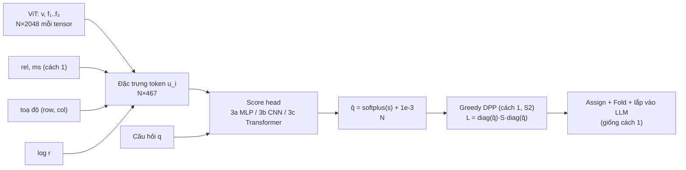

# Cách 3 — Score head: mạng nhỏ chấm điểm từng token, r cố định

- Trạng thái: Đề xuất (mở rộng; làm sau khi cách 1 đạt M5 và cách 2 đạt M6)
- Bao nhiêu token: **r cố định** (7 mức) · Token nào: **điểm học được + DPP + Fold** (S2–S4 của cách 1 giữ nguyên)
- Ký hiệu và giao thức chung: [`README.md`](README.md)

## 0. Tóm tắt nhanh

**Một câu:** giữ nguyên toàn bộ DSFold (DPP, Assign, Fold), chỉ thay **công
thức chấm điểm token** ở S1 bằng một **mạng nhỏ học được**. Mạng này nhận
nhiều đặc trưng hơn cho mỗi token (main stream, 3 tầng DeepStack, vị trí, câu
hỏi).

**Học thế nào (khuyến nghị):** tuyến B. Với mỗi câu GQA train, chạy full token
một lần, lấy **saliency** của từng token (token đó ảnh hưởng tới câu trả lời
bao nhiêu), rồi dạy mạng **xếp hạng** token giống saliency.

### 0.1 Các mức ngân sách dùng trong cách này

Giống cách 1: **r cố định**, chạy riêng từng mức. Một mạng dùng chung cho mọi
mức, nhờ có đặc trưng `log r`.

| Mức | L7 | L6 | L5 | L4 | L3 | L2 | L1 |
| --- | ---: | ---: | ---: | ---: | ---: | ---: | ---: |
| **r** | **100%** | **75%** | **50%** | **33,3%** | **22,2%** | **11,1%** | **5,6%** |
| `log r` đưa vào mạng | 0 | −0,288 | −0,693 | −1,099 | −1,504 | −2,197 | −2,890 |
| Dùng khi huấn luyện tuyến A | không | không | có | có | có | có | có |

Ở tuyến A, mỗi bước huấn luyện lấy ngẫu nhiên một mức trong L1–L5. L6 và L7
gần như không mất thông tin nên không cần học. Lúc đánh giá thì chạy cả 7 mức
như cách 1.

### 0.2 Luồng dữ liệu (lúc suy luận)



### 0.3 Ví dụ số: chi phí của score head trên ảnh GQA trung vị (N = 260)

| Kiến trúc | Phép tính chính | MAC ước tính | So với LLM prefill ở L3 (119 GMAC) |
| --- | --- | ---: | ---: |
| 3a MLP | 260 × (979·512 + 512·256) + các projection 260 × (2048·256 + 3·2048·64) | ≈ 0,40 GMAC | ≈ 0,3% |
| 3b CNN | 3 conv 3×3 trên lưới 20×13: 3 × 260 × 9 × 256 × 256 + các projection | ≈ 0,73 GMAC | ≈ 0,6% |
| 3c Transformer | self-attention 260² × 256 + cross-attention + FFN + các projection | ≈ 0,68 GMAC | ≈ 0,6% |

Cả ba đều rẻ hơn rất nhiều so với một decoder layer (≈ 4,2 GMAC ở N_total′ = 84).

## 1. Bài toán

Ở cách 1, điểm chất lượng là một công thức cố định:

```
quality_i = exp(α·z(rel)_i + β·z(ms)_i)
```

Công thức này chỉ dùng hai tín hiệu thủ công, và giả định chúng kết hợp theo
dạng log-tuyến tính.

**Cách 3:** thay `quality` bằng `q̂_i = softplus(s_θ(i)) + 1e-3`. Trong đó `s_θ`
là một mạng nhỏ nhận **nhiều đặc trưng hơn** cho mỗi token và học từ dữ liệu
xem token nào thật sự quan trọng.

**Giữ nguyên:**
- DPP (S2), để chống trùng lặp bằng toán thay vì bắt mạng phải tự học điều này;
- Assign và Fold (S3–S4);
- cách lắp vào model (README mục 4).

Như vậy mạng chỉ phải học **một việc**: token i quan trọng tới đâu cho câu hỏi
này. Việc học sẽ dễ hơn và ít overfit hơn.

## 2. Đặc trưng cho mỗi token i

| Thành phần | Định nghĩa | Kích thước |
| --- | --- | ---: |
| Main stream | `P_v(v_i)`, `P_v: Linear(2048 → 256)` | 256 |
| DeepStack | `P_l(f̂_l[i])` cho l = 1, 2, 3, mỗi `P_l: Linear(2048 → 64)` riêng (`f̂` đã chuẩn hoá như cách 1, mục 3.3) | 192 |
| Đặc trưng thủ công | `z(rel)_i`, `z(ms)_i` (cách 1) | 2 |
| Vị trí | Fourier features của `(row_i/H′, col_i/W′)`: `sin(2^k·π·x)`, `cos(2^k·π·x)` với k = 0..3 | 16 |
| Mức ngân sách | `log r` (một mạng dùng chung cho mọi r) | 1 |

`u_i` có tổng 467 chiều. Câu hỏi được biểu diễn bằng:
- `x_q = P_q(mean_j q̃_j)`, `P_q: Linear(2048 → 256)`, dùng cho 3a và 3b;
- hoặc từng token `P_q(q_j)`, dùng cho 3c.

## 3. Ba kiến trúc (thử theo thứ tự)

### 3a — MLP cho từng token (không có bối cảnh)

```
in_i = [ u_i ; x_q ; P_v(v_i) ⊙ x_q ]                  # 467 + 256 + 256 = 979
s_i  = Linear(256 → 1)( GELU(Linear(512 → 256)( GELU(Linear(979 → 512)(in_i)) )) )
```

- Tham số: projections khoảng 1,44M, MLP khoảng 0,63M, tổng **khoảng 2,1M**.
- Chi phí: `O(N)`.

### 3b — CNN nhỏ trên lưới token (bối cảnh cục bộ)

```
h⁰ = Linear(467 → 256)(u_i), sắp lại thành lưới [256, H′, W′]
(γ_c, β_c) = Linear(256 → 512)(x_q)                                  # FiLM theo câu hỏi
for b = 1..3:
    h^b = h^{b−1} + GELU( γ_c ⊙ Conv3×3(256 → 256, padding = 1)(h^{b−1}) + β_c )
s = Conv1×1(256 → 1)(h³), duỗi lại thành [N]
```

- Vùng nhìn (receptive field): 7 × 7 token, tức 224 × 224 pixel.
- Tham số: 3 conv × 590.080 cộng các projections và FiLM, tổng **khoảng 3,5M**.
- Chi phí: `O(N)`.
- **Vì sao CNN hợp ở đây:** visual token của Qwen3-VL xếp được thành lưới 2D,
  nên conv 3×3 thấy được token có nằm trên cạnh, góc, hay ranh giới vật thể
  không. Đây là thông tin mà MLP cho từng token không có.

### 3c — Một khối transformer nhẹ (bối cảnh toàn ảnh và câu hỏi)

```
h   = Linear(467 → 256)(u)                                  # [N, 256]
h   = h + SelfAttn_4head(LN(h))                             # token nhìn nhau
h   = h + CrossAttn_4head(LN(h), P_q(q))                    # token nhìn câu hỏi
h   = h + FFN(256 → 1024 → 256)(LN(h))
s   = Linear(256 → 1)(LN(h))
```

- Tham số: **khoảng 2,6M**.
- Chi phí: `O(N²·256)`. Với N = 1.750 khoảng 0,8 GMAC, vẫn nhỏ so với LLM prefill.

## 4. Tuyến huấn luyện B (làm trước): học theo saliency

### 4.1 Tạo nhãn saliency

Với mỗi mẫu GQA train:
1. Chạy **full token** và lấy câu trả lời greedy `y = (y_1..y_A)`, A ≤ 8 token,
   không tính EOS.
2. Tách `v` và `f_l` khỏi đồ thị ViT (`detach().requires_grad_(True)`).
3. Teacher-forcing để tính `log p(y) = Σ_t log p(y_t | prompt, y_{<t})`.
4. Một lần backward để lấy gradient theo `v` và `f_l` (không cần gradient trọng
   số; trọng số đặt `requires_grad=False`).
5. Saliency, dùng gradient × input:
   ```
   sal_i = |⟨∂log p/∂v_i, v_i⟩| + Σ_{l=1..3} |⟨∂log p/∂f_l[i], f_l[i]⟩|
   ```
   Giá trị này xấp xỉ bậc nhất mức thay đổi của `log p` khi token i bị xoá
   (đặt về 0).
6. Lưu `sal ∈ R^N` (fp16) cùng mọi đặc trưng cần cho `u_i`.

**Chi phí ước tính:** ViT forward + LLM forward + LLM backward ≈ `0,155 · (0,46 + 3 · 0,54)`
≈ 0,32 s mỗi mẫu. Với 50k mẫu khoảng **4,5 giờ**, tính dư là **khoảng 6 giờ**.
VRAM: activation của 28 layer ở N_total khoảng 300 với batch 1, ước tính vài GB
(phải đo).

Ablation: Integrated Gradients 8 bước (chi phí × 8) trên 5k mẫu, để kiểm tra
saliency bậc nhất có đủ tin cậy không.

### 4.2 Loss xếp hạng (ListNet)

```
t_i = sal_i / mean_i(sal)                                    # chuẩn hoá theo ảnh
P   = softmax(t / T_t),   T_t = 0,5                          # phân phối "đích"
Q   = softmax(s)                                             # phân phối dự đoán
L   = − Σ_i P_i · log Q_i
```

Loss chỉ quan tâm **thứ hạng tương đối** giữa các token trong cùng một ảnh,
đúng với cách DPP sử dụng điểm.

| Thiết lập | Giá trị |
| --- | --- |
| Tối ưu | AdamW, lr 3e-4, weight decay 1e-2 |
| Batch | 16 ảnh (đệm theo N) |
| Epoch | 10, early stopping trên 10% tách theo `image_id` |
| Thời gian | dưới 1 giờ (không cần VLM, chỉ dùng đặc trưng đã lưu) |

### 4.3 Hạn chế của tuyến B

Saliency đo mức quan trọng **khi có đủ token**, không đo được tương tác sau khi
cắt. Ví dụ, hai token cùng quan trọng nhưng trùng nhau thì chỉ cần giữ một;
phần này DPP xử lý một phần.

## 5. Tuyến huấn luyện A (nếu tuyến B cho tín hiệu tốt): chưng cất end-to-end

### 5.1 Ý tưởng

Huấn luyện `s_θ` sao cho câu trả lời của model **khi đã cắt** gần nhất với
câu trả lời full-token. Gradient đi qua model 2B đã đóng băng.

### 5.2 Làm cho việc chọn token khả vi

1. **Chọn cứng (forward):** `z = 1[i ∈ DPP(q̂, K)]`, tức đúng bộ chọn của lúc
   suy luận. Fold được tính từ z và tách khỏi đồ thị gradient.
2. **Cổng mềm (backward):** `g_i = σ(s_i / t)`, với t = 1.
3. **Straight-through:** `z̃_i = z_i + g_i − stopgrad(g_i)`. Giá trị forward
   bằng z; gradient đi qua g.
4. **Đưa vào LLM mà không xoá token** (để giữ tensor cố định và lan được gradient):
   - **Attention bias:** cộng `b_i = log(z̃_i + ε)` (ε = 1e-4, tức b ≈ −9,2 cho
     token bị bỏ) vào attention logits của **key** tại vị trí ảnh i, ở mọi layer
     và mọi head. Cách làm: tạo một custom 4D float attention mask
     `[1, 1, N_total, N_total]` = causal mask cộng `b` phát đều theo hàng.
   - **DeepStack:** dùng `z̃_i · f′_l[i]`, nên token bị bỏ không nhận residual DeepStack.
   - ⚠️ **Phải kiểm tra trước (spike khoảng 1 ngày):** Qwen3-VL text model trong
     Transformers 5.x có nhận custom 4D float mask với `sdpa` không. Nếu không,
     dùng `attn_implementation="eager"` (chậm hơn, tốn VRAM hơn).
5. Lúc suy luận vẫn **xoá thật** token (README mục 4). Trong không gian
   attention, bias −9,2 gần tương đương với việc xoá.

### 5.3 Loss

```
L = (1/A) Σ_{t=1..A} KL( p_T(· | y_{<t}) ‖ p_S(· | y_{<t}) )      # teacher = full token, teacher-forced bằng y của teacher
  + μ · CE(y_gt)                                                    # mặc định μ = 0
  + ρ · ( mean_i g_i − r )²                                         # ρ = 1: giữ cổng mềm bám theo ngân sách
```

- Mỗi bước, r được lấy ngẫu nhiên từ {L1..L5}, và `log r` có trong đặc trưng.
  Nhờ vậy **một mạng** dùng được cho mọi mức.
- Phân phối teacher `p_T` của A vị trí trả lời được tính **trước** một lần, chỉ
  lưu top-64 logit để tiết kiệm dung lượng.

### 5.4 Thiết lập và chi phí (ước tính, phải đo)

| Mục | Giá trị |
| --- | --- |
| Khởi tạo | trọng số từ tuyến B |
| Tối ưu | AdamW, lr 1e-4, batch hiệu dụng 8 (batch 1 × tích luỹ 8), 2 epoch trên 50k mẫu |
| Bộ nhớ | bf16 + gradient checkpointing trên LLM; ước tính 10–16 GB VRAM |
| Thời gian | khoảng 0,35 s mỗi mẫu mỗi lượt × 100k lượt ≈ 10 giờ, cộng khoảng 2 giờ tính teacher |

## 6. Thí nghiệm

| Câu hỏi | So sánh (cùng r, cùng DPP, cùng Fold) |
| --- | --- |
| Điểm học được có hơn công thức thủ công không? | cách 3 so với cách 1 ở 7 mức r |
| Kiến trúc nào đủ? | 3a / 3b / 3c |
| Tuyến nào tốt hơn? | B (saliency) / A (chưng cất) |
| Có cần DPP khi đã học điểm không? | `q̂` + DPP so với top-K theo `q̂` |
| Đặc trưng nào quan trọng? | bỏ DeepStack / bỏ vị trí / bỏ `rel`, `ms` |
| Tổng quát hoá | học trên GQA, đánh giá trên MMBench và MME |

Chất lượng xếp hạng trên GQA val:
- Spearman giữa `s` và `sal`;
- recall@K: tỉ lệ top-K saliency nằm trong `I_keep`.

## 7. Rủi ro

| Rủi ro | Giảm thiểu |
| --- | --- |
| Overfit GQA | giữ DPP; có đặc trưng thủ công; kiến trúc nhỏ; dropout 0,1 |
| Saliency nhiễu | ablation Integrated Gradients; dùng thứ hạng (ListNet) thay vì giá trị tuyệt đối |
| Custom 4D mask không chạy với `sdpa` | dùng eager; hoặc chỉ làm tuyến B |
| Hết VRAM ở tuyến A | batch 1 + checkpointing; rút A ≤ 4 token; hoặc bỏ tuyến A |
| Lợi ích nhỏ so với cách 1 | vẫn là kết luận có giá trị: "công thức thủ công đã đủ" |

## 8. Liên hệ paper

| Paper | Quan hệ |
| --- | --- |
| DynamicViT | nguồn gốc kỹ thuật cổng mềm + straight-through (tuyến A) |
| VisPruner, TReVS | điểm thủ công, dùng làm đối chứng |
| RUTA (2608.04132), ETC (2606.00543) | có học trên Qwen3-VL. Cách 3 khác ở chỗ chỉ học điểm, vẫn giữ DPP + Fold DeepStack, và dùng nhãn saliency rẻ |

## 9. Tiêu chí thành công

| Mốc | Tiêu chí |
| --- | --- |
| M7a | có nhãn saliency cho 50k mẫu; recall@K của 3a ≥ recall@K của `quality` thủ công trên GQA val |
| M7b | cách 3 (tuyến B) thắng cách 1 ở ≥ 2 mức r trên GQA testdev, CI không chứa 0 |
| M7c | (tuỳ chọn) tuyến A chạy được trong VRAM hiện có và thắng tuyến B |
