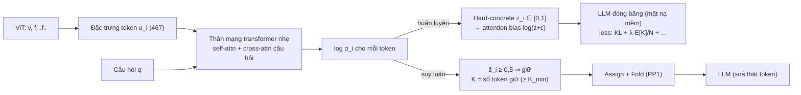

# PP4 — Học toàn bộ: cổng học được quyết cả "bao nhiêu" lẫn "token nào"

- Trạng thái: Đề xuất (**hướng phát triển**; chỉ triển khai nếu PP1–2 xong sớm và còn ≥ 3–4 tuần)
- Bao nhiêu token: **học** · Token nào: **học** · Fold DeepStack (S3–S4 của PP1): **giữ nguyên**
- Bắt đầu ngay, **không chờ thành viên khác**: tự cài PP1 theo [`../pp1-dsfold/method.md`](../pp1-dsfold/method.md) với bộ D (dùng S3–S4 Fold và `I_DPP` để neo), qua bài kiểm tra PP1 mục 13
- Phần tự làm trong phương pháp này: mạng cổng (mục 2), spike custom 4D attention mask (mục 4.1), huấn luyện (mục 5–6)
- Ký hiệu và giao thức chung: [`00-common/README.md`](../00-common/README.md)

## 0. Tóm tắt nhanh

**Một câu:** một mạng nhỏ (khoảng 2,6M tham số) cho **mỗi token** một cổng
đóng/mở. Số cổng mở chính là K, nên K **tự thay đổi theo từng mẫu**. Mạng
được huấn luyện end-to-end qua model 2B đóng băng, để cân bằng "giữ câu trả
lời như full-token" và "dùng ít token".

**Khác PP2:**
- PP2 chọn một trong 7 mức rồi để DSFold chọn token.
- PP4 không có mức rời rạc: mạng quyết **cả hai** việc.

### 0.1 Các mức ngân sách trong cách này

PP4 **không chọn mức** lúc suy luận: K là số cổng mở, có thể là bất kỳ số
nào trong `[K_min, N]`. Các mức L1–L7 chỉ xuất hiện ở bốn chỗ:

| Chỗ dùng | Mức | Vai trò |
| --- | --- | --- |
| Chặn dưới | L1 = 5,6% ⇒ `K_min = ⌈0,056·N⌉` | không bao giờ giữ ít hơn mức nhỏ nhất đã đánh giá |
| Neo lúc huấn luyện | L3 = 22,2% | `I_DPP` là lựa chọn của DSFold ở L3 (số hạng (5) trong mục 5) |
| Điểm vận hành | λ ∈ {0,25; 0,5; 1; 2; 4} ⇒ mỗi λ cho một `r̄` thực tế | các `r̄` này được so với đường của PP1 và PP2 |
| So sánh | đường nội suy qua L1–L7 của PP1 | xem mạng nằm trên hay dưới đường đó |

Kỳ vọng định tính (phải đo): λ = 0,25 cho `r̄` khoảng 40–60%, còn λ = 4 cho
`r̄` khoảng 5–10%.

### 0.2 Luồng dữ liệu



### 0.3 Ví dụ số về rate penalty (ảnh GQA trung vị, N = 260)

| Đại lượng | Giá trị ví dụ |
| --- | --- |
| Mạng mở `E[K] = Σ π_i` = 65 cổng | `E[K]/N = 0,25` |
| Số hạng rate với λ = 1 | `λ · 0,25 = 0,25` |
| Nếu đóng thêm 26 cổng (`E[K]` = 39, tức 15%) | rate giảm còn 0,15 (giảm 0,10). Mạng chỉ đóng thêm khi KL tăng **ít hơn 0,10** |
| Cùng tình huống với λ = 4 | rate giảm 0,40, nên mạng chấp nhận KL tăng tới 0,40 để tiết kiệm thêm |

λ chính là "giá" của mỗi 1% token tính theo đơn vị KL. λ càng lớn thì mạng
càng sẵn sàng hy sinh chất lượng để tiết kiệm token.

## 1. Bài toán

Một mạng `s_θ` gán cho mỗi visual token i một **cổng** `z_i ∈ [0, 1]`:
- `z_i = 0` nghĩa là bỏ;
- `z_i = 1` nghĩa là giữ.

Số token giữ lại `K = Σ_i 1[z_i > 0]` **không cố định** mà do mạng tự quyết cho
từng mẫu. Mạng được huấn luyện để cân bằng hai mục tiêu:
- **utility**: câu trả lời khi cắt gần nhất với câu trả lời full-token;
- **rate**: dùng càng ít token càng tốt.

Đây là khung **rate–utility**, giống RUTA (2608.04132). Điểm khác chính:
token bị bỏ vẫn được **Fold vào DeepStack** của token giữ lại, và mạng nhận
đặc trưng DeepStack.

## 2. Kiến trúc

**Đặc trưng cho mỗi token i** (`u_i`, 466 chiều):

| Thành phần | Định nghĩa | Kích thước |
| --- | --- | ---: |
| Main stream | `P_v(v_i)`, `P_v: Linear(2048 → 256)` | 256 |
| DeepStack | `P_l(f̂_l[i])` cho l = 1, 2, 3, mỗi `P_l: Linear(2048 → 64)` riêng (`f̂` chuẩn hoá như PP1 mục 3.3) | 192 |
| Đặc trưng thủ công | `z(rel)_i`, `z(ms)_i` tính như PP1 mục 3.2–3.4 | 2 |
| Vị trí | Fourier features của `(row_i/H′, col_i/W′)`: `sin(2^k·π·x)`, `cos(2^k·π·x)`, k = 0..3 | 16 |

Câu hỏi: từng token `P_q(q_j)`, với `P_q: Linear(2048 → 256)`.

**Thân mạng** (một khối transformer nhẹ, d = 256):

```
h      = Linear(466 → 256)(u)                         # [N, 256]
h      = h + SelfAttn_4head(LN(h))                    # token nhìn nhau
h      = h + CrossAttn_4head(LN(h), P_q(q))           # token nhìn câu hỏi
h      = h + FFN(256 → 1024 → 256, GELU)(LN(h))
log α  = Linear(256 → 1)(LN(h))                        # [N]
```

- Không đưa `log r` vào, vì r do mạng tự quyết.
- Tham số: **khoảng 2,6M**, phần lớn nằm ở `P_v`, `P_l`, `P_q`.
- Khởi tạo: ngẫu nhiên (Xavier). Bias của lớp cuối đặt bằng
  `β · log(−γ/ζ)` ≈ −1,6 (với β, γ, ζ ở mục 3), để lúc bắt đầu `π_i ≈ 0,5` cho
  mọi token.

## 3. Cổng hard-concrete (Louizos và cộng sự, ICLR 2018)

Phân phối hard-concrete cho phép z có xác suất dương **đúng bằng 0** hoặc **đúng
bằng 1**, đồng thời vẫn lấy được đạo hàm nhờ reparameterization.

**Lúc huấn luyện (lấy mẫu):**
```
u_i  ~ Uniform(0, 1)
c_i  = σ( (log u_i − log(1 − u_i) + log α_i) / β )            β = 2/3
c̄_i  = c_i · (ζ − γ) + γ                                       γ = −0,1,  ζ = 1,1
z_i  = min(1, max(0, c̄_i))                                     # z ∈ [0, 1], có khối xác suất tại 0 và 1
```

**Xác suất cổng mở (khả vi theo `log α`):**
```
π_i = P(z_i > 0) = σ( log α_i − β · log(−γ / ζ) )
E[K] = Σ_i π_i
```

**Lúc suy luận (tất định):**
```
ẑ_i    = min(1, max(0, σ(log α_i) · (ζ − γ) + γ))
I_keep = { i : ẑ_i ≥ 0,5 }
nếu |I_keep| < K_min = ⌈0,056 · N⌉:  lấy K_min token có log α lớn nhất
nếu |I_keep| > N:                    không xảy ra
```

`K_min` giữ cho phương pháp nằm trong khoảng ngân sách đã đánh giá (≥ L1).

## 4. Đưa cổng vào LLM lúc huấn luyện

### 4.1 Spike kỹ thuật (làm đầu tiên, khoảng 1 ngày)

Kiểm tra rằng Qwen3-VL text model trong Transformers 5.x nhận được **custom 4D
float attention mask** `[1, 1, N_total, N_total]` với `attn_implementation="sdpa"`:
1. truyền mask = causal mask (0 / −∞) cộng một bias b ở các cột ảnh;
2. với b ≡ 0, logit phải **trùng** khi không truyền mask;
3. với b = −1e4 ở một nửa số cột ảnh, logit phải **gần** kết quả khi xoá thật
   các token đó (sai lệch nhỏ do softmax);
4. gradient theo b phải khác 0.

Nếu `sdpa` không nhận mask này thì dùng `attn_implementation="eager"` (chậm và
tốn VRAM hơn). Phải ghi kết quả spike vào báo cáo của PP4.

### 4.2 Cách đưa cổng vào

Không cần straight-through, vì `z_i` đã khả vi theo `log α_i`:

- **Attention bias:** cộng `b_i = log(z_i + ε)`, với ε = 1e-4, vào logits của
  key tại vị trí ảnh i, ở mọi layer và head (custom 4D float mask).
- **Main stream:** giữ `v_i`. Việc "bỏ" được thực hiện qua attention bias.
- **DeepStack:** `z_i · f_l[i]`.
- **Fold:** tính từ tập cứng `{i : z_i > 0}` của mẫu hiện tại, tách khỏi gradient.
  Fold chỉ cộng vào token đang mở.

Lúc suy luận thì **xoá thật** token theo `I_keep`, rồi lắp vào model theo
phần chung (`00-common`) mục 4.

## 5. Hàm mục tiêu

```
L = (1/A) Σ_{t=1..A} KL( p_T(·|y_{<t}) ‖ p_S(·|y_{<t}) )          (1) utility: giữ hành vi full-token
  + μ · CE(y_gt)                                                    (2) tuỳ chọn, mặc định μ = 0
  + λ · E[K] / N                                                    (3) rate: phạt tỉ lệ token kỳ vọng
  + η · (1/N²) Σ_{i≠j} π_i π_j · max(0, S_ij − s₀)                  (4) chống trùng lặp khả vi, s₀ = 0,8
  + κ(t) · BCE( π, 1[i ∈ I_DPP] )                                   (5) neo theo lời giải DSFold
```

Giải thích từng thành phần:

1. **KL** so với teacher full-token, tính trên A ≤ 8 token trả lời của
   teacher (teacher-forced). Teacher được tính trước, lưu top-64 logit.
2. **CE** theo đáp án đúng. Tắt mặc định để mục tiêu là "giữ hành vi baseline".
3. **Rate:** λ càng lớn thì mạng càng tiết kiệm. **Mỗi giá trị λ cho một điểm**
   trên đường Pareto.
4. **Chống trùng lặp:** phạt việc mở đồng thời hai token rất giống nhau
   (`S_ij = cos(v_i, v_j) > 0,8`). Đây là thay thế khả vi cho DPP.
5. **Neo theo DPP:** `I_DPP` là lựa chọn của DSFold (PP1) ở mức L3 = 22,2%.
   κ(t) giảm dần về 0 (mục 6), để mạng khởi đầu từ một lời giải tốt rồi tự điều chỉnh.

## 6. Lịch huấn luyện

| Giai đoạn (% số bước) | λ | κ | Mục đích |
| --- | --- | --- | --- |
| 0–10% | 0 | 1 | học bắt chước DSFold, chưa ép tiết kiệm |
| 10–30% | tăng tuyến tính 0 → λ_target | 1 → 0,5 | bắt đầu cân bằng rate |
| 30–50% | λ_target | 0,5 → 0 | bỏ dần neo |
| 50–100% | λ_target | 0 | tối ưu rate–utility thuần |

| Thiết lập | Giá trị |
| --- | --- |
| λ_target | {0,25; 0,5; 1; 2; 4}, mỗi giá trị huấn luyện riêng |
| η | 0,1 |
| Tối ưu | AdamW, lr 1e-4, batch hiệu dụng 8, 2 epoch trên 50k mẫu GQA train |
| Bộ nhớ | bf16 + gradient checkpointing; ước tính 10–16 GB VRAM (phải đo) |
| Thời gian | khoảng 10 giờ mỗi λ ⇒ khoảng 50 giờ cho 5 giá trị λ, cộng teacher khoảng 2 giờ. Tổng **khoảng 3–5 ngày GPU** |
| Chọn checkpoint | theo `agree` trên 2.000 câu GQA val ở mỗi λ |

## 7. Các chế độ hỏng thường gặp và cách phát hiện

| Hiện tượng | Dấu hiệu theo dõi | Xử lý |
| --- | --- | --- |
| Mọi cổng đóng (K → K_min) | `E[K]/N` giảm nhanh, KL tăng vọt | giảm λ; kéo dài giai đoạn neo |
| Mọi cổng mở (K → N) | `E[K]/N` ≈ 1 | tăng λ; kiểm tra khởi tạo bias |
| Cổng không quyết đoán (π ≈ 0,5) | histogram π tập trung quanh 0,5 | giảm β (nhiệt độ) về 0,5 ở nửa sau |
| Chọn token trùng nhau | trung bình `S_ij` giữa các token giữ lại cao hơn DSFold | tăng η |
| Lệch train/test | `agree` khi xoá thật thấp hơn rõ so với khi dùng bias | so sánh hai chế độ trên GQA val; tăng độ lớn bias (ε nhỏ hơn) |

## 8. Thí nghiệm

| Câu hỏi | So sánh |
| --- | --- |
| Học toàn bộ có hơn PP2 (budget head + DSFold) không? | cùng `r̄` thực tế, dùng nội suy đường Pareto (PP2, mục 9) |
| Fold còn giúp khi đã học cổng không? | có / không có S3–S4 |
| Neo DPP và số hạng chống trùng lặp có cần không? | κ ≡ 0; η = 0 |
| Tổng quát hoá | GQA → MMBench, MME |
| So với RUTA | chỉ so định tính với số liệu RUTA báo cáo (Qwen3-VL-8B, khác kích thước model; ghi rõ) |

## 9. Rủi ro

| Rủi ro | Mức | Giảm thiểu |
| --- | --- | --- |
| Huấn luyện không ổn định | cao | lịch ở mục 6; theo dõi mục 7 |
| Tốn GPU nhất | cao | ít giá trị λ; dùng 25k mẫu trước |
| Cạnh tranh trực tiếp với RUTA | cao | điểm khác: Fold DeepStack, đặc trưng DeepStack, model 2B, neo DPP |
| Overfit GQA | trung bình | neo DPP, chống trùng lặp, đánh giá ngoài miền |

## 10. Đóng góp nếu làm được

- Khung rate–utility có **Fold DeepStack** và đặc trưng DeepStack cho Qwen3-VL.
- So sánh có hệ thống trên cùng một khung, cùng dữ liệu và cùng đối chứng, theo
  ba mức học:
  - không học (PP1);
  - học một phần chọn K (PP2) hoặc học điểm token (PP3);
  - học toàn bộ (PP4).

## 11. Khuyến nghị cho khoá luận

Trình bày PP4 ở chương **hướng phát triển**, gồm thiết kế ở mục 2–6 và lý do
chưa triển khai (chi phí, rủi ro). Chỉ triển khai khi PP1 và 2 đã có đủ kết
quả trên cả 3 benchmark.
